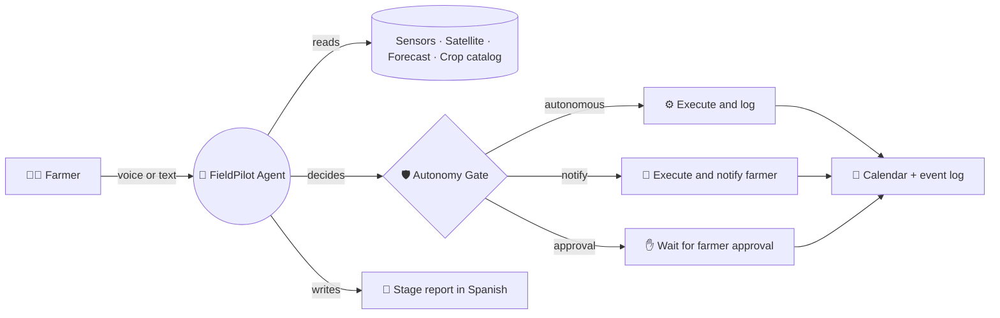
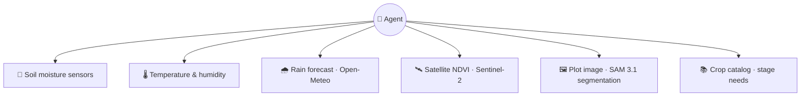
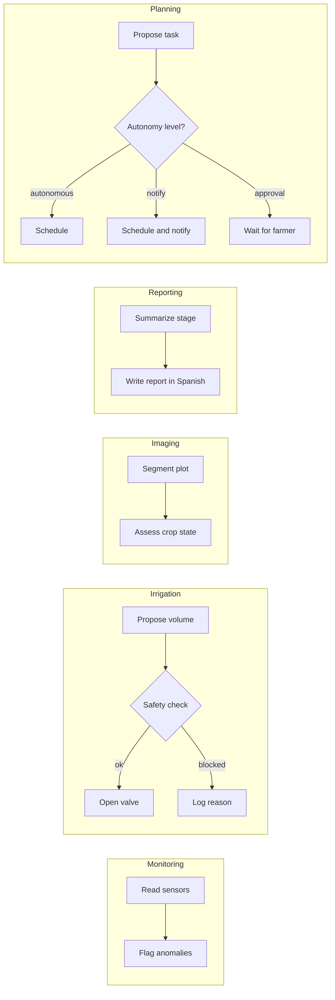
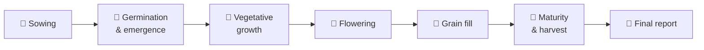
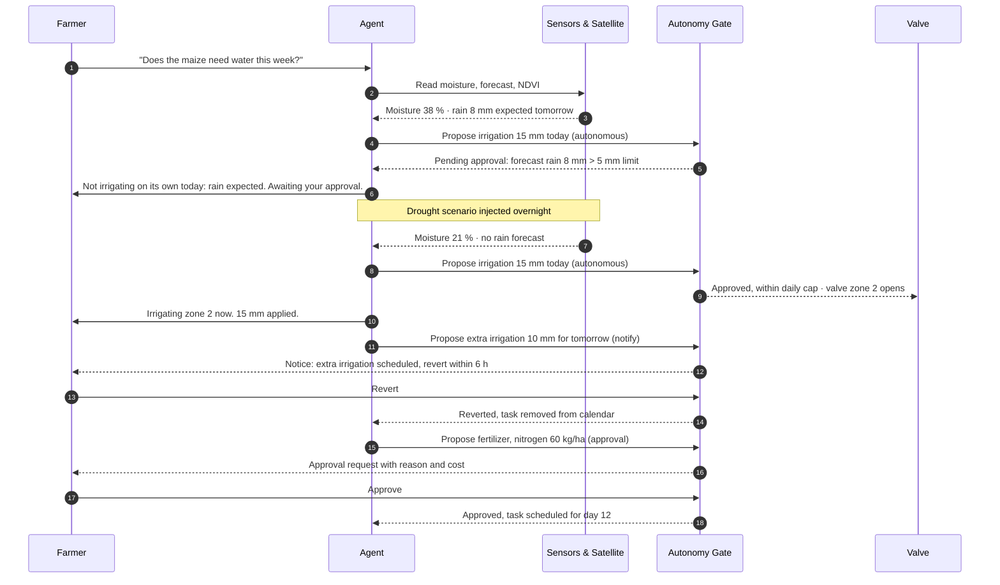
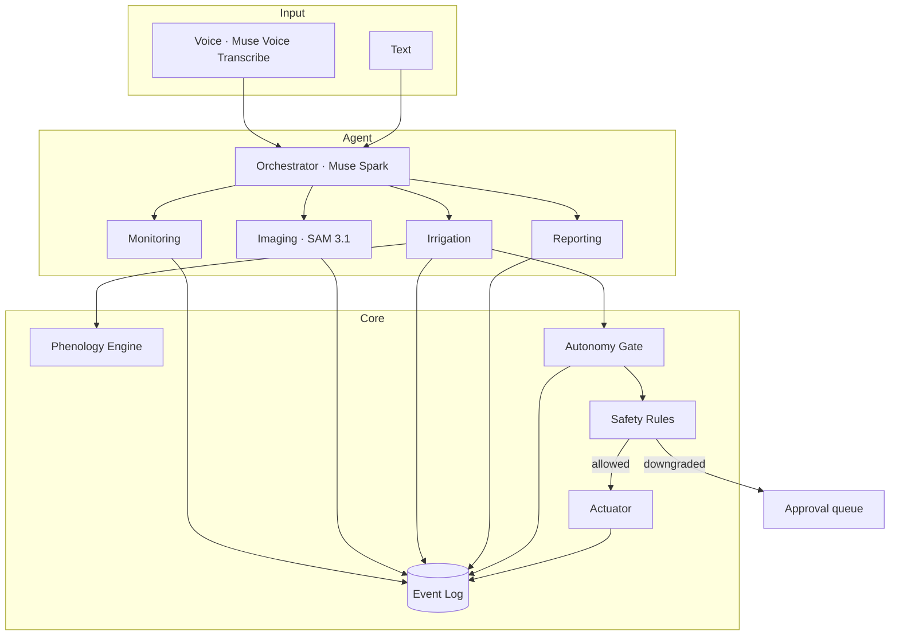

# FieldPilot 🌱

**An AI agent that runs a crop cycle the way a careful farmer would.**
It reads soil sensors and satellite imagery, makes most operational decisions
on its own within safe limits, asks the farmer before anything that changes
the economics or the land, and explains every decision in plain language.

> Built during the Meta Global AI Developer Hackathon (Oct 26 – Nov 4, 2026).
> Track: Indie Developer · Theme: *Build for Your World*

---

## What it does in one picture



The agent **decides** most things on its own. A deterministic gate checks
every action against its autonomy level and safety rules before it runs.
The farmer always sees **what** happened and **why**.

---

## What the agent looks at



| Source | What it tells the agent | Used for |
|---|---|---|
| Soil moisture | Water available in the root zone | Irrigation decision |
| Temperature & humidity | Growing conditions | Stage progress, stress alerts |
| Rain forecast | Rain expected in the next 24 h | Blocking unnecessary irrigation |
| NDVI (satellite) | Vegetation health over time | Detecting stress before it shows |
| Plot image | Outline and visible crop condition | Plot boundaries, imaging report |
| Crop catalog | Water and nutrient needs per stage | Deciding how much and when |

---

## What the agent can do



### Autonomy levels

The agent acts on its own where the risk is low and reversible. It asks first
where a decision changes the economics of the farm, the soil, or what the
farmer sells.

| Level | What the agent does | Examples | Farmer's role |
|---|---|---|---|
| **Autonomous** | Acts and records the reason | Irrigation within limits, stress alerts, stage reports, calendar updates | Can review the log |
| **Notify** | Acts and sends a notice; the farmer can undo within a time window | Small extra irrigation, calendar shifts of up to 2 days, pest scouting visits | Can revert within 6 hours |
| **Approval** | Proposes and waits; does not act until confirmed | Fertilizer and agrochemicals, planting date changes, harvest timing, listing a product for sale, price changes | Accepts or rejects with one tap |

Chemical injection is never automated. Fertilizer and agrochemical tasks always
sit in the approval level.

### Safety rules

Enforced in code (`backend/app/safety/rules.py`) and covered by tests. They
apply at every autonomy level.

| Rule | Default |
|---|---|
| Max irrigation per zone per day | 20 mm |
| Skip irrigation if rain forecast (24 h) exceeds | 5 mm |
| Minimum interval between irrigations per zone | 12 h |
| Do not irrigate above field-capacity threshold | 85 % |
| Emergency stop | Global flag, checked before every action |

Any action that would exceed these limits is downgraded to the approval level,
not executed. Example: an extra irrigation of 25 mm in one day becomes a
pending approval for the farmer.

---

## The life of a maize crop

The agent follows the crop through its stages and adjusts the calendar at each one.



| Stage | Water need | Typical tasks on the calendar | Autonomy level |
|---|---|---|---|
| Sowing | Moderate, keep soil moist | Prepare soil, sow, first irrigation | Sowing date: approval · Irrigation: autonomous |
| Germination & emergence | Frequent, light | Monitor moisture, check emergence | Autonomous |
| Vegetative growth | High | Irrigation schedule, nitrogen fertilizer | Irrigation: autonomous · Fertilizer: approval |
| Flowering | Highest | Strict moisture monitoring, stress alerts | Autonomous (alerts) · Extra irrigation: notify |
| Grain fill | High, then reducing | Irrigation adjustment, pest scouting | Irrigation: autonomous · Scouting visit: notify |
| Maturity & harvest | Reduce to stop | Stop irrigation, harvest date, traceability record | Harvest date: approval · Stop irrigation: autonomous |

Stages are estimated from accumulated degree-days, so the calendar updates
when the real weather is hotter or cooler than expected. Changes to the
calendar that move a task more than 2 days are downgraded to approval.

---

## A day in the life of the agent

The scenario below shows the three autonomy levels in one day. It is the
flow the three-minute demo follows.



---

## Quick start

**Prerequisites:** [uv](https://docs.astral.sh/uv/) (manages Python 3.12, see
[D002](docs/decisions.md)), Node.js 20+, `make`.

```bash
cp .env.example .env        # add your Meta Model API key, or keep MOCK_LLM=1
make install
make dev                    # backend :8000 · frontend :5173
make test                   # backend tests, mock mode, no network
make check                  # lint + type-check + tests
```

`make seed` (demo farm and maize cycle) arrives with build step 11.

Without an API key, the agent runs in **mock mode** with recorded responses,
so the simulator, calendar and autonomy gate can still be exercised.

---

## Status

Work in progress during the hackathon. A box is ticked only when the feature
passes its tests. Design decisions are logged in
[`docs/decisions.md`](docs/decisions.md).

- [x] 1. Scaffold: backend, frontend, Makefile, architecture and decision docs
- [x] 2. Domain models and SQLite persistence
- [ ] 3. Field simulator with accelerated clock and scenarios
- [ ] 4. Phenology engine (maize)
- [ ] 5. Safety rules and autonomy gate
- [ ] 6. Simulated actuator and NOTIFY revert window
- [ ] 7. Agent orchestrator and subagents
- [ ] 8. Satellite NDVI and segmentation
- [ ] 9. REST API
- [ ] 10. Frontend dashboard
- [ ] 11. Demo seed and end-to-end test

---

## Architecture



The language model never actuates hardware. Every proposal passes through the
autonomy gate, which applies the autonomy level, then the safety rules.
Module contracts and the data model are in [`docs/architecture.md`](docs/architecture.md).

**Stack:** Python 3.12 · FastAPI · SQLite · React · Vite · pytest
**Models:** Muse Spark (agent) · Muse Voice Transcribe (speech) · SAM 3.1 (segmentation)
**Data:** Open-Meteo (forecast) · Sentinel-2 (cached for the demo)

---

## Scope and limitations

- Sensors are **simulated** in the demo. The interface is built for real hardware but has not been tested with it.
- Satellite imagery is **cached**. Live retrieval is not part of the demo.
- Crop parameters are simplified, from one public agronomic reference per crop. An agronomist should review them before real use.
- Autonomy levels and thresholds are defaults for the demo. A real deployment would let each farm adjust them within safe bounds.
- No payments or marketplace in this version.

## Roadmap

- [ ] Real sensor adapters (MQTT)
- [ ] Live satellite retrieval
- [ ] Traceability records and harvest listings for buyers
- [ ] Offline mode with Muse Spark Open or Glimmer
- [ ] Approval actions from a mobile notification

## Team

- Edwin Suarez: software architecture, agent orchestration
- [teammates]

## License

MIT