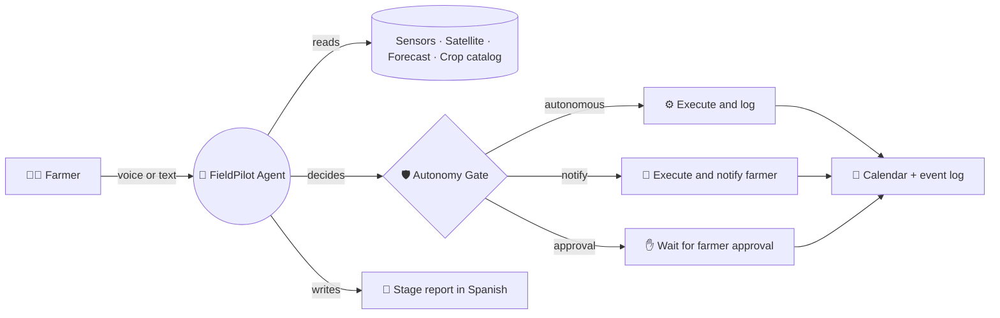
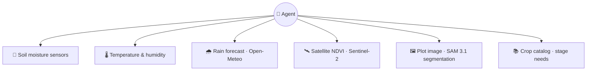
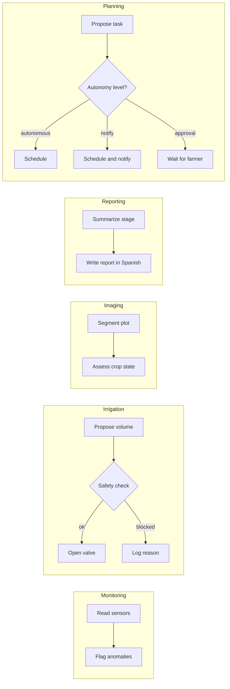
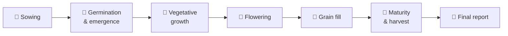
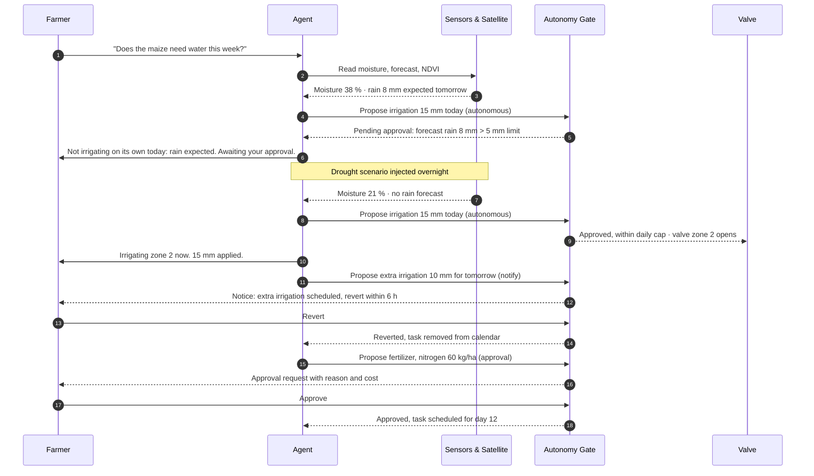
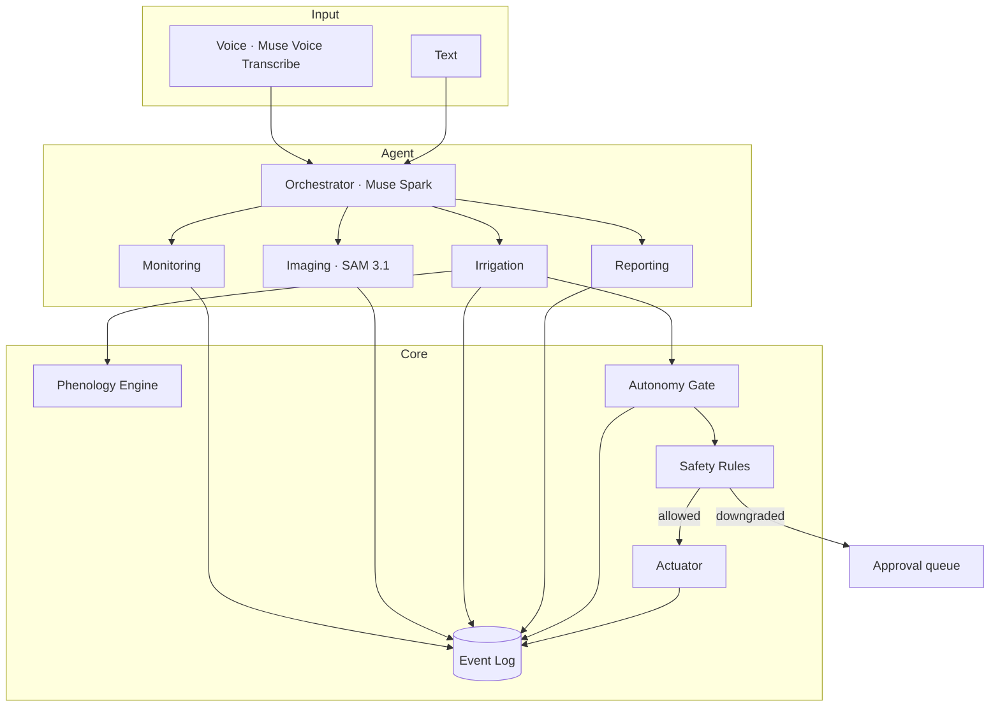

# FieldPilot 🌱

**An AI agent that runs a crop cycle the way a careful farmer would.**
It reads soil sensors and satellite imagery, makes most operational decisions
on its own within safe limits, asks the farmer before anything that changes
the economics or the land, and explains every decision in plain language.

> Built during the Meta Global AI Developer Hackathon (Oct 26 – Nov 4, 2026).
> Track: Indie Developer · Theme: *Build for Your World*

---

## What it does in one picture



The agent **decides** most things on its own. A deterministic gate checks
every action against its autonomy level and safety rules before it runs.
The farmer always sees **what** happened and **why**.

---

## What the agent looks at



| Source | What it tells the agent | Used for |
|---|---|---|
| Soil moisture | Water available in the root zone | Irrigation decision |
| Temperature & humidity | Growing conditions | Stage progress, stress alerts |
| Rain forecast | Rain expected in the next 24 h | Blocking unnecessary irrigation |
| NDVI (satellite) | Vegetation health over time | Detecting stress before it shows |
| Plot image | Outline and visible crop condition | Plot boundaries, imaging report |
| Crop catalog | Water and nutrient needs per stage | Deciding how much and when |

---

## What the agent can do



### Autonomy levels

The agent acts on its own where the risk is low and reversible. It asks first
where a decision changes the economics of the farm, the soil, or what the
farmer sells.

| Level | What the agent does | Examples | Farmer's role |
|---|---|---|---|
| **Autonomous** | Acts and records the reason | Irrigation within limits, stress alerts, stage reports, calendar updates | Can review the log |
| **Notify** | Acts and sends a notice; the farmer can undo within a time window | Small extra irrigation, calendar shifts of up to 2 days, pest scouting visits | Can revert within 6 hours of simulated time |
| **Approval** | Proposes and waits; does not act until confirmed | Fertilizer and agrochemicals, planting date changes, harvest timing, listing a product for sale, price changes | Accepts or rejects with one tap |

Chemical injection is never automated. Fertilizer and agrochemical tasks always
sit in the approval level.

**What "revert" means** ([D007](docs/decisions.md)). The window is measured on
the simulated clock, and the backend alone decides whether it is open. A
paused clock pauses the window.

- A scheduled task is cancelled before anything runs.
- A running irrigation is stopped, and the water already applied is recorded
  in millimetres and litres.
- Water that has already been applied cannot be undone, so that revert is
  refused and logged.

A scheduled task is checked again by the autonomy gate when its time comes.
If the new verdict needs approval, for example because rain is now forecast,
the task does not run, and the farmer is told which rule changed
([D033](docs/decisions.md)). After a restart, nothing runs a second time. An
irrigation the restart may have cut is reported with its amount as unknown
([D013](docs/decisions.md), [D032](docs/decisions.md)).

### Safety rules

Enforced in code (`backend/app/safety/rules.py`) and covered by tests. They
apply at every autonomy level.

| Rule | Default |
|---|---|
| Max irrigation per zone per day | 20 mm |
| Skip irrigation if rain forecast (24 h) exceeds | 5 mm |
| Minimum interval between irrigations per zone | 12 h |
| Do not irrigate above field-capacity threshold | 85 % |
| Emergency stop | Global flag, checked before every action |

Any action that would exceed these limits is downgraded to the approval level,
not executed. Example: an extra irrigation of 25 mm in one day becomes a
pending approval for the farmer.

---

## The life of a maize crop

The agent follows the crop through its stages and adjusts the calendar at each one.



| Stage | Starts at (°C·day) | Kc | Moisture target (% FC) | Typical tasks on the calendar | Autonomy level |
|---|---|---|---|---|---|
| Sowing | 0 | 0.30 | 60–80 | Prepare soil, sow, first irrigation | Sowing date: approval · Irrigation: autonomous |
| Germination (to emergence) | 20 | 0.30 | 65–80 | Monitor moisture, check emergence | Autonomous |
| Vegetative growth | 55.6 | 0.30 → 1.20 (V3 → V12) | 55–80 | Irrigation schedule, nitrogen fertilizer | Irrigation: autonomous · Fertilizer: approval |
| Flowering | 788.9 | 1.20 | **70**–80 | Strict moisture monitoring, stress alerts | Autonomous (alerts) · Extra irrigation: notify |
| Grain fill | 936.7 | 1.20 | 60–80 | Irrigation adjustment, pest scouting | Irrigation: autonomous · Scouting visit: notify |
| Maturity & harvest | 1291.1 | 1.20 → 0.60 | 40–70 | Stop irrigation, harvest date, traceability record | Harvest date: approval · Irrigation: notify · Stop irrigation: autonomous |

Physiological maturity (black layer) is reached at 1472.2 °C·day. The catalog
is [`config/crops/maize.yaml`](config/crops/maize.yaml).

Kc follows its own FAO-56 curve, independent of the stages (D030): 0.30
until V3 (192.2 °C·day), rising to 1.20 at effective full cover, V12
(566.7), flat until R5 (1291.1), then falling to 0.60 at R6 (1472.2).

**How to read the numbers.**

- **Degree-days and Kc.** Stage thresholds come from Ohio State AGF-0101
  Table 1 (adapted from Iowa State PMR 1009 and Nielsen 2021), which
  publishes them in °F·day. They were converted with °C·day = °F·day ÷ 1.8;
  for example, VE is 100 ÷ 1.8 = 55.6. Daily GDD use the Modified 86/50 °F
  method as published by Purdue. Kc values come from FAO-56 Table 12. Both
  were checked against those sources on 2026-10-28 (D031).
- **Kc ini is verified against the online edition of FAO-56.** The 0.30 used
  at sowing is the cereals group value, inherited by the maize row. The
  original PDF was not checked (D031).
- **Kc curve points are a project mapping.** FAO-56 places them by ground
  cover and maturity, not by leaf stage. V3, V12 and R5 were chosen, the
  earlier stage where the window is uncertain. That overestimates ET, and so
  applies more water than needed, in V3–V6 and V12–V15; the 20 mm/day cap
  bounds the effect (D030).
- **Sowing–germination boundary.** The 20 °C·day start of germination is a
  project decision, not agronomic data. The sources define no boundary
  between sowing and germination.
- **Not agronomist-reviewed.** These are reference values for US Corn Belt
  hybrids and FAO standard conditions. They are not reviewed by an
  agronomist and must be calibrated with local data, for example for Neiva,
  Huila, before real use (D017, D020).
- **Moisture targets and nutrient amounts.** These are demo values with no
  agronomic source.
- **Flowering.** It has the highest moisture floor, because it is the
  stage most sensitive to water stress.
- **Maturity and the 70 % ceiling.** The 40–70 % range at maturity is a
  *target* that lets the grain dry. It is not a safety limit. The safety
  rule ("do not irrigate above 85 % of field capacity") still applies
  everywhere. Irrigation at maturity is raised to *notify*, so the farmer
  sees any watering at that stage.

Stages are estimated from accumulated degree-days, so the calendar updates
when the real weather is hotter or cooler than expected. Changes to the
calendar that move a task more than 2 days are downgraded to approval.

---

## A day in the life of the agent

The scenario below shows the three autonomy levels in one day. It is the
flow the three-minute demo follows.



---

## Quick start

**Prerequisites:** [uv](https://docs.astral.sh/uv/) (manages Python 3.12, see
[D002](docs/decisions.md)), Node.js 24 (`frontend/.nvmrc`), `make`.

```bash
cp .env.example .env        # add your Meta Model API key, or keep MOCK_LLM=1
make install
make dev                    # backend :8000 · frontend :5173
make test                   # backend tests, mock mode, no network
make check                  # what CI runs: hygiene, backend and frontend
```

`make seed` (demo farm and maize cycle) arrives with build step 11.

For a live demo, `APP_PROFILE=demo DEMO_REVERT_WINDOW_SECONDS=600` shortens
the revert window. It can only shorten the window, every shortening is logged,
and any other profile refuses to start with the variable set
([D010](docs/decisions.md), [D036](docs/decisions.md)).

Without an API key, the agent runs in **mock mode** with recorded responses,
so the simulator, calendar and autonomy gate can still be exercised.

---

## Status

[](https://github.com/EdwinSteve/FieldPilot/actions/workflows/ci.yml)

Work in progress during the hackathon. The plan for steps 7–11 is in
[`docs/roadmap.md`](docs/roadmap.md). Every pull request runs the same
Makefile targets as `make check`, in three jobs: repository hygiene, backend
and frontend ([D041](docs/decisions.md)). The backend job enforces readability
rules: complexity, unused code, no `print` and no naive datetimes. Findings
appear inline on the pull request ([D042](docs/decisions.md)). A box is ticked only when the feature
passes its tests. Design decisions are logged in
[`docs/decisions.md`](docs/decisions.md).

- [x] 1. Scaffold: backend, frontend, Makefile, architecture and decision docs
- [x] 2. Domain models and SQLite persistence
- [x] 3. Field simulator with accelerated clock and scenarios
- [x] 4. Phenology engine (maize)
- [x] 5. Safety rules and autonomy gate
- [x] 6. Simulated actuator and NOTIFY revert window
- [x] 7. Agent orchestrator and subagents
- [ ] 8. Satellite NDVI and segmentation
- [ ] 9. REST API
- [ ] 10. Frontend dashboard
- [ ] 11. Demo seed and end-to-end test

---

## Architecture



The language model never actuates hardware. Every proposal passes through the
autonomy gate, which applies the autonomy level, then the safety rules.
Module contracts and the data model are in [`docs/architecture.md`](docs/architecture.md).

**Stack:** Python 3.12 · FastAPI · SQLite · React · Vite · pytest
**Models:** Muse Spark (agent) · Muse Voice Transcribe (speech) · SAM 3.1 (segmentation)
**Data:** Open-Meteo (forecast) · Sentinel-2 (cached for the demo)

---

## Scope and limitations

- Sensors are **simulated** in the demo. The interface is built for real hardware but has not been tested with it.
- Satellite imagery is **cached**. Live retrieval is not part of the demo.
- Crop parameters are reference values, each with its source in the YAML. They are not calibrated for local conditions and have not been reviewed by an agronomist ([D017, D020](docs/decisions.md)).
- Autonomy levels and thresholds are defaults for the demo. A real deployment would let each farm adjust them within safe bounds.
- No payments or marketplace in this version.

## Roadmap

- [ ] Real sensor adapters (MQTT)
- [ ] Live satellite retrieval
- [ ] Traceability records and harvest listings for buyers
- [ ] Offline mode with Muse Spark Open or Glimmer
- [ ] Approval actions from a mobile notification

## Team

- Edwin Suarez: software architecture, agent orchestration
- [teammates]

## License

MIT