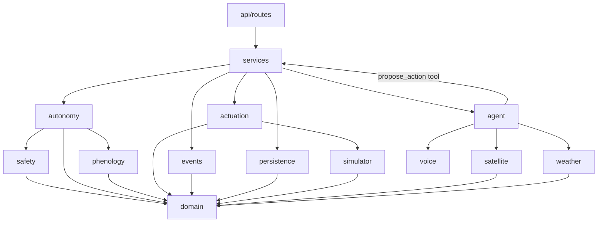
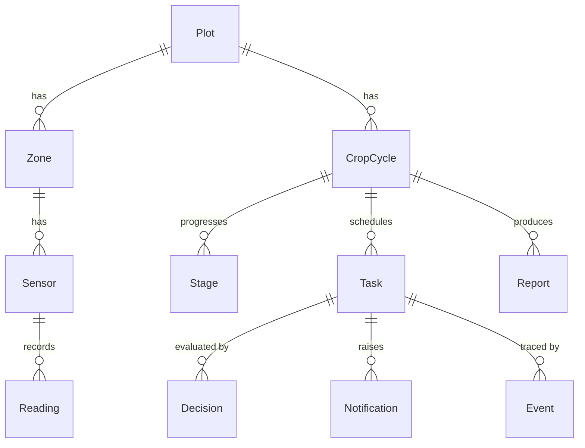

# FieldPilot Architecture

This document defines the module boundaries, their contracts and the data
model. Code must follow it. Changes to this file need explicit confirmation
and, when they resolve an ambiguity, an entry in [`decisions.md`](decisions.md).

Contracts are written as Python signatures. They describe intent, not final
spelling; small renames during implementation are fine as long as the
responsibilities and dependency directions stay the same.

---

## 1. Principles

1. **The LLM proposes; it never actuates.** Agent tools can only create
   `ProposedAction`s. The `Actuator` is never handed to the agent layer.
2. **One path to execution.** Every action goes through
   `ProposalService` → `AutonomyGate.evaluate()` → `Actuator.execute()`.
   Nothing else calls the actuator.
3. **Pure core, I/O at the edges.** Safety rules, autonomy resolution,
   phenology math and NDVI are pure functions over value objects. Database,
   HTTP, files and the clock are reached through interfaces (`Protocol`s) and
   injected.
4. **Dependencies point inward.** `api → services → (autonomy, safety,
   phenology, actuation, agent…) → domain`. `domain` imports nothing from
   the app.
5. **Config, not code.** Autonomy levels (`config/autonomy.yaml`), safety
   limits (`config/safety.yaml`, see D001) and crop data
   (`config/crops/*.yaml`) are loaded once at startup, validated, and passed
   on as immutable objects.
6. **Everything is an event.** Every proposal, verdict, execution, revert,
   approval and rejection is appended to the event log with its inputs, the
   level and rule that applied, and a human-readable reason.
7. **Time is injected.** Domain code never calls `datetime.now()`. It
   receives a `Clock`. The simulator provides an accelerated one. All
   timestamps are timezone-aware UTC.
8. **No global mutable state.** Dependencies are built in
   `app/container.py` and passed explicitly. Runtime state such as the
   emergency stop lives in the database.

---

## 2. Layering



The agent package depends on a narrow `ProposalPort` interface, not on
`ProposalService` directly. Proposals reach the gate, but the agent cannot
reach the actuator.

---

## 3. Core domain types (`app/domain`)

```python
class AutonomyLevel(StrEnum):      # ordered by strictness
    AUTONOMOUS = "autonomous"
    NOTIFY = "notify"
    APPROVAL = "approval"

def strictest(*levels: AutonomyLevel) -> AutonomyLevel: ...

class ActionType(StrEnum):
    IRRIGATION = "irrigation"
    EXTRA_IRRIGATION = "extra_irrigation"
    STOP_IRRIGATION = "stop_irrigation"
    STRESS_ALERT = "stress_alert"
    STAGE_REPORT = "stage_report"
    CALENDAR_SHIFT = "calendar_shift"
    SCOUTING_VISIT = "scouting_visit"
    FERTILIZER = "fertilizer"
    AGROCHEMICAL = "agrochemical"
    PLANTING_DATE_CHANGE = "planting_date_change"
    HARVEST_TIMING = "harvest_timing"
    PRODUCT_LISTING = "product_listing"
    PRICE_CHANGE = "price_change"
    CHEMICAL_INJECTION = "chemical_injection"   # never executable (D005)

class TaskStatus(StrEnum):
    PENDING_APPROVAL = "pending_approval"
    SCHEDULED = "scheduled"      # committed, waiting for scheduled_for
    EXECUTED = "executed"        # physically applied or completed
    REVERTED = "reverted"
    REJECTED = "rejected"
    FAILED = "failed"

class GateOutcome(StrEnum):
    EXECUTE = "execute"                    # AUTONOMOUS
    EXECUTE_AND_NOTIFY = "execute_notify"  # NOTIFY
    AWAIT_APPROVAL = "await_approval"      # APPROVAL (requested or downgraded)

@dataclass(frozen=True)
class ProposedAction:
    action_type: ActionType
    plot_id: int
    zone_id: int | None
    scheduled_for: datetime
    params: Mapping[str, float | str]   # e.g. {"volume_mm": 15}
    rationale: str                      # agent's explanation, shown to farmer
    estimated_cost: Money | None
    proposed_by: str                    # "agent:irrigation", "farmer", "system"

@dataclass(frozen=True)
class RuleViolation:
    rule: str          # stable id, e.g. "irrigation.daily_cap"
    reason: str        # human-readable, includes the numbers

@dataclass(frozen=True)
class GateVerdict:
    outcome: GateOutcome
    requested_level: AutonomyLevel      # from policy and stage mapping
    effective_level: AutonomyLevel      # after downgrade
    violations: tuple[RuleViolation, ...]
    reason: str
```

---

## 4. Module contracts

### 4.1 Safety (`app/safety/rules.py`): pure, mypy strict

Pure functions only: no I/O, no clock, no database. Each rule takes the
proposal, a `SafetyContext` snapshot and the `SafetyLimits`. It returns
`RuleViolation | None`.

```python
@dataclass(frozen=True)
class SafetyLimits:                       # loaded from config/safety.yaml (D001)
    max_irrigation_mm_per_zone_per_day: float     # 20
    rain_forecast_skip_mm_24h: float              # 5
    min_hours_between_irrigations: float          # 12
    max_soil_moisture_pct_of_field_capacity: float  # 85
    max_calendar_shift_days: float                # 2

@dataclass(frozen=True)
class SafetyContext:                      # built by the caller, read-only snapshot
    now: datetime
    emergency_stop_active: bool
    irrigated_mm_on_day: float            # executed + scheduled, same zone and day
    last_irrigation_at: datetime | None
    soil_moisture_pct_of_fc: float | None
    rain_forecast_mm_24h: float | None
    calendar_shift_days: float | None     # for CALENDAR_SHIFT / date changes

def check_emergency_stop(a, ctx, limits) -> RuleViolation | None: ...
def check_daily_irrigation_cap(a, ctx, limits) -> RuleViolation | None: ...
def check_rain_forecast(a, ctx, limits) -> RuleViolation | None: ...
def check_min_interval(a, ctx, limits) -> RuleViolation | None: ...
def check_field_capacity(a, ctx, limits) -> RuleViolation | None: ...
def check_calendar_shift(a, ctx, limits) -> RuleViolation | None: ...

ALL_RULES: tuple[Rule, ...]
def evaluate_rules(a, ctx, limits) -> tuple[RuleViolation, ...]: ...
```

Boundary convention: a value **equal** to a limit is allowed, and only
values strictly above it violate. For example, 20 mm is allowed and 20.1 mm
is a violation. Missing data needed by an irrigation rule (for example, no
forecast) counts as a violation. This is the safer option.

### 4.2 Autonomy (`app/autonomy`): mypy strict

```python
class AutonomyPolicy:                     # loaded from config/autonomy.yaml
    def default_level(self, action_type: ActionType) -> AutonomyLevel: ...
    revert_window: timedelta              # revert_window_seconds, default 21600 (D007, D010)

class AutonomyGate:
    def __init__(self, policy: AutonomyPolicy, limits: SafetyLimits) -> None: ...
    def evaluate(
        self,
        action: ProposedAction,
        ctx: SafetyContext,
        stage_level: AutonomyLevel | None,   # from phenology stage mapping
    ) -> GateVerdict: ...
```

`evaluate` is pure and deterministic. It runs in this order:

1. `requested = strictest(policy.default_level(type), stage_level)`. A stage
   mapping can only make the level stricter (D006).
2. `violations = evaluate_rules(action, ctx, limits)`.
3. If there are any violations, the effective level is `APPROVAL`
   (downgrade). Otherwise it is `requested`.
4. The effective level maps to the outcome: `AUTONOMOUS → EXECUTE`,
   `NOTIFY → EXECUTE_AND_NOTIFY`, `APPROVAL → AWAIT_APPROVAL`.

There is no "drop" outcome. A blocked action is always visible to the farmer
as a pending approval with the rule and reason (D004).

### 4.3 Proposal service (`app/services/proposals.py`)

The only orchestrator of the execution path. It implements `ProposalPort`
for the agent.

```python
class ProposalPort(Protocol):
    def propose(self, action: ProposedAction) -> ProposalResult: ...

class ProposalService(ProposalPort):
    def propose(self, action) -> ProposalResult:
        # 1. log PROPOSAL event
        # 2. build SafetyContext (repositories, forecast, clock, emergency flag)
        # 3. verdict = gate.evaluate(...); log GATE_VERDICT + Decision row
        # 4. create Task with status from verdict
        # 5. EXECUTE / EXECUTE_AND_NOTIFY -> actuator.execute(task); log EXECUTION
        #    EXECUTE_AND_NOTIFY -> Notification with revert_deadline
        # 6. return ProposalResult(task, verdict)
```

Related use cases in `app/services`:

- `approve_task(task_id, actor)` re-checks the emergency stop only, then
  executes and logs `APPROVAL` and `EXECUTION`.
- `reject_task(task_id, actor, reason)` logs `REJECTION`.
- `revert_task(task_id, actor)` follows D007.
- `set_emergency_stop(active, actor)`.

### 4.4 Actuation (`app/actuation`)

```python
class Actuator(Protocol):
    def execute(self, task: Task) -> ExecutionResult: ...
    def revert(self, task: Task) -> RevertResult: ...

class SimulatedActuator(Actuator):        # drives FieldSimulator valves
```

The actuator refuses to execute while the emergency stop is active. This is
a defense in depth on top of the gate. Only physical action types are
supported: irrigation, stop irrigation and calendar shift. Fertilizer and
agrochemical tasks, once approved, become manual tasks for the farmer. The
actuator never runs them. Chemical injection has no command (D005).

### 4.5 Event log (`app/events`)

```python
class EventLog(Protocol):
    def append(self, event: NewEvent) -> Event: ...
    def list(self, filters: EventFilter) -> Sequence[Event]: ...
```

The log is append-only: no updates and no deletes. It is the only logging
channel for decisions, and the code has no `print` statements.

### 4.6 Simulator (`app/simulator`)

```python
class Clock(Protocol):
    def now(self) -> datetime: ...

class SimClock(Clock):                    # start + speed factor, or manual advance
    def advance(self, delta: timedelta) -> None: ...

class SensorSource(Protocol):
    def read(self, zone_id: int, at: datetime) -> Sequence[SensorReading]: ...

class FieldSimulator(SensorSource):
    def apply_irrigation(self, zone_id: int, volume_mm: float) -> None: ...
    def inject(self, scenario: Scenario) -> None: ...   # DROUGHT, HEAVY_RAIN
    def step(self, delta: timedelta) -> None: ...       # water balance, temperature
```

### 4.7 Phenology (`app/phenology`)

```python
@dataclass(frozen=True)
class StageSpec:
    name: str
    gdd_start: float
    water_need_mm_per_day: float
    nutrient_need: Mapping[str, float]               # kg/ha, e.g. {"N": 60}
    autonomy: Mapping[ActionType, AutonomyLevel]     # stage mapping

@dataclass(frozen=True)
class CropSpec:
    name: str
    base_temp_c: float
    upper_temp_c: float
    stages: tuple[StageSpec, ...]

def load_crop_catalog(path: Path) -> Mapping[str, CropSpec]: ...
def daily_gdd(t_min: float, t_max: float, crop: CropSpec) -> float: ...  # pure
def stage_for(gdd: float, crop: CropSpec) -> StageSpec: ...              # pure
```

### 4.8 Agent (`app/agent`)

```python
class LLMClient(Protocol):
    def complete(self, messages: Sequence[Message], tools: Sequence[ToolSpec]) -> LLMResponse: ...
# MuseClient(model=settings.muse_agent_model, ...) · MockLLMClient(fixtures_dir)

@dataclass(frozen=True)
class Tool(Generic[In, Out]):
    name: str
    description: str
    input_model: type[In]                 # pydantic model -> JSON schema
    handler: Callable[[In], Out]

class ToolRegistry:
    def register(self, tool: Tool) -> None: ...
    def subset(self, names: Iterable[str]) -> "ToolRegistry": ...
    def call(self, name: str, raw_args: Mapping[str, object]) -> ToolCallRecord: ...

@dataclass(frozen=True)
class Subagent:
    name: str                             # monitoring | irrigation | imaging | reporting
    system_prompt: str
    tool_names: frozenset[str]

class Orchestrator:
    def run(self, user_message: str, plot_id: int) -> AgentResult: ...
    # bounded loop: at most settings.agent_max_steps model calls

@dataclass(frozen=True)
class AgentResult:
    answer: str
    trace: tuple[ToolCallRecord, ...]     # name, args, result or error, duration, step
    stopped_by_step_limit: bool
```

Only the Irrigation subagent holds `propose_action`, which calls
`ProposalPort.propose`. The other subagents have read-only tools. The mock
client replays recorded responses keyed by scenario and step, so it is
deterministic.

### 4.9 Satellite, weather and voice

```python
def compute_ndvi(red: NDArray[np.float32], nir: NDArray[np.float32]) -> NDArray[np.float32]: ...
class ImageryLoader: def load(self, plot_id: int, date: date) -> Scene: ...   # data/satellite/
class SegmentationProvider(Protocol):
    def segment(self, image: NDArray[np.uint8], prompt: str) -> Mask: ...
# Sam31Segmentation · MockSegmentation (rectangular mask)

class ForecastProvider(Protocol):
    def rain_next_24h_mm(self, lat: float, lon: float, at: datetime) -> float: ...
# OpenMeteoForecast (httpx) · FixtureForecast (data/fixtures/open_meteo/)

class SpeechToText(Protocol):
    def transcribe(self, audio: bytes, language: str) -> str: ...
# MuseVoiceTranscribe · MockSpeechToText
```

---

## 5. Data model (SQLite via SQLModel)



| Table | Key fields |
|---|---|
| **Plot** | id, name, latitude, longitude, area_ha, created_at |
| **Zone** | id, plot_id, name, area_ha, field_capacity_pct, valve_id |
| **Sensor** | id, zone_id, kind (`soil_moisture`, `temperature`, `humidity`), unit |
| **Reading** | id, sensor_id, value, recorded_at |
| **CropCycle** | id, plot_id, crop, sowing_date, accumulated_gdd, status (`active`, `completed`) |
| **Stage** | id, cycle_id, name, started_at, ended_at, gdd_at_start |
| **Task** | id, cycle_id, zone_id?, action_type, params (JSON), scheduled_for, status, effective_level, rationale, estimated_cost?, revert_deadline?, created_at, updated_at |
| **Decision** | id, task_id, requested_level, effective_level, outcome, violations (JSON), reason, inputs (JSON snapshot of the `SafetyContext`), created_at |
| **Event** | id, occurred_at (sim clock), kind, actor, task_id?, decision_id?, autonomy_level?, rule?, reason, inputs (JSON) |
| **Notification** | id, task_id?, message, created_at, read_at?, revert_deadline? |
| **Report** | id, cycle_id, stage_id?, language, content (markdown), created_at |
| **ControlState** | id (single row), emergency_stop_active, changed_at, changed_by |

`Event.kind` takes one of these values: `proposal`, `gate_verdict`,
`execution`, `revert`, `approval`, `rejection`, `notification`,
`emergency_stop`, `stage_transition`, `agent_tool_call`.

---

## 6. Configuration files

```yaml
# config/autonomy.yaml
revert_window_seconds: 21600   # 6 h; demo-only override in D010
defaults:
  irrigation: autonomous
  extra_irrigation: notify
  stop_irrigation: autonomous
  stress_alert: autonomous
  stage_report: autonomous
  calendar_shift: notify
  scouting_visit: notify
  fertilizer: approval
  agrochemical: approval
  planting_date_change: approval
  harvest_timing: approval
  product_listing: approval
  price_change: approval
  chemical_injection: approval
```

```yaml
# config/safety.yaml
irrigation:
  max_mm_per_zone_per_day: 20
  rain_forecast_skip_mm_24h: 5
  min_hours_between: 12
  max_soil_moisture_pct_of_field_capacity: 85
calendar:
  max_shift_days: 2
```

At load time the app checks that every `ActionType` has a level, and that
the mandatory-approval types are set to `approval` (D005). If either check
fails, the app does not start.

---

## 7. REST API

| Method | Path | Service |
|---|---|---|
| GET | `/health` | — |
| GET/POST | `/plots`, `/zones` | plots |
| GET | `/readings` | readings |
| GET | `/cycles`, `/cycles/{id}` | cycles |
| GET | `/tasks` | tasks |
| POST | `/tasks/{id}/approve` | `approve_task` |
| POST | `/tasks/{id}/reject` | `reject_task` (D008) |
| POST | `/tasks/{id}/revert` | `revert_task` |
| GET | `/events` | event log |
| GET | `/notifications` | notifications |
| GET | `/reports` | reports |
| POST | `/agent/chat` | `Orchestrator.run` (text or audio) |
| POST | `/emergency-stop` | `set_emergency_stop` |

Route handlers parse the request, call one service function and map the
result to a response. They contain no other logic. Domain errors map to HTTP
codes in one place: not found is 404, an invalid state transition is 409,
and an unsupported action is 422.
