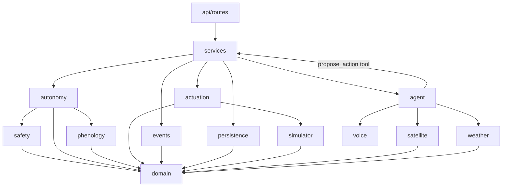
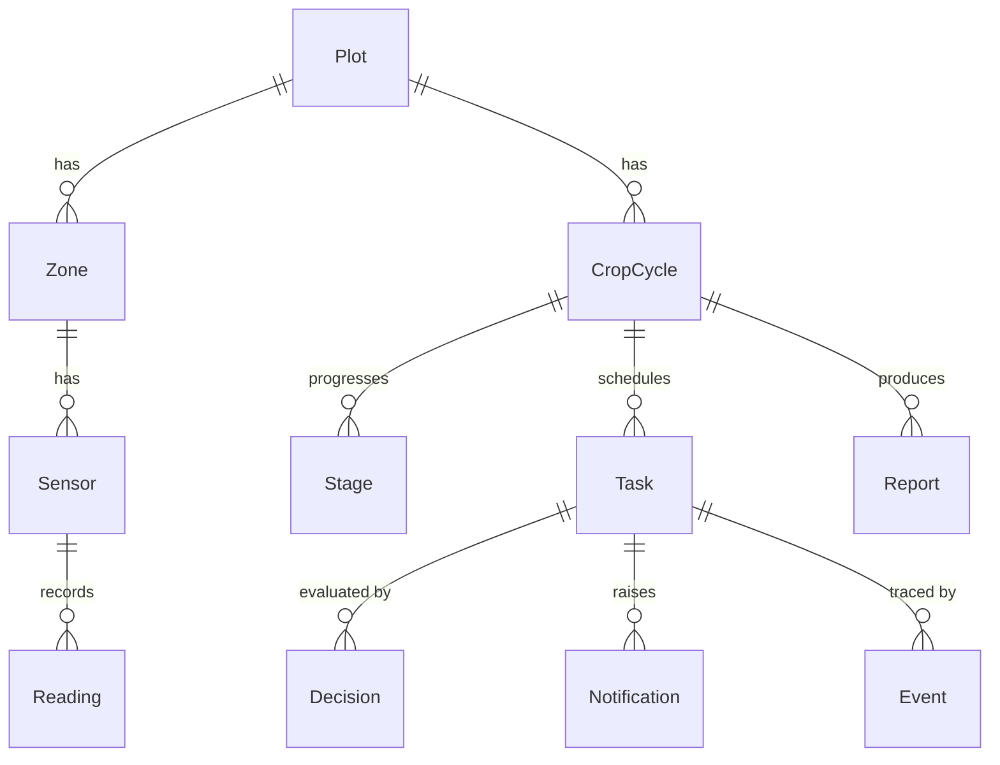

# FieldPilot Architecture

This document defines the module boundaries, their contracts and the data
model. Code must follow it. Changes to this file need explicit confirmation
and, when they resolve an ambiguity, an entry in [`decisions.md`](decisions.md).

Contracts are written as Python signatures. They describe intent, not final
spelling; small renames during implementation are fine as long as the
responsibilities and dependency directions stay the same.

---

## 1. Principles

1. **The LLM proposes; it never actuates.** Agent tools can only create
   `ProposedAction`s. The `Actuator` is never handed to the agent layer.
2. **One path to execution.** Every action goes through
   `ProposalService` → `AutonomyGate.evaluate()` → `Actuator.execute()`.
   Nothing else calls the actuator.
3. **Pure core, I/O at the edges.** Safety rules, autonomy resolution,
   phenology math and NDVI are pure functions over value objects. Database,
   HTTP, files and the clock are reached through interfaces (`Protocol`s) and
   injected.
4. **Dependencies point inward.** `api → services → (autonomy, safety,
   phenology, actuation, agent…) → domain`. `domain` imports nothing from
   the app.
5. **Config, not code.** Autonomy levels (`config/autonomy.yaml`), safety
   limits (`config/safety.yaml`, see D001) and crop data
   (`config/crops/*.yaml`) are loaded once at startup, validated, and passed
   on as immutable objects.
6. **Everything is an event.** Every proposal, verdict, execution, revert,
   approval and rejection is appended to the event log with its inputs, the
   level and rule that applied, and a human-readable reason.
7. **Time is injected.** Domain code never calls `datetime.now()`. It
   receives a `Clock`. The simulator provides an accelerated one. All
   timestamps are timezone-aware UTC.
8. **No global mutable state.** Dependencies are built in
   `app/container.py` and passed explicitly. Runtime state such as the
   emergency stop lives in the database.

---

## 2. Layering



The agent package depends on a narrow `ProposalPort` interface, not on
`ProposalService` directly. Proposals reach the gate, but the agent cannot
reach the actuator.

---

## 3. Core domain types (`app/domain`)

```python
class AutonomyLevel(StrEnum):      # ordered by strictness
    AUTONOMOUS = "autonomous"
    NOTIFY = "notify"
    APPROVAL = "approval"

def strictest(*levels: AutonomyLevel) -> AutonomyLevel: ...

class ActionType(StrEnum):
    IRRIGATION = "irrigation"
    EXTRA_IRRIGATION = "extra_irrigation"
    STOP_IRRIGATION = "stop_irrigation"
    STRESS_ALERT = "stress_alert"
    STAGE_REPORT = "stage_report"
    CALENDAR_SHIFT = "calendar_shift"
    SCOUTING_VISIT = "scouting_visit"
    FERTILIZER = "fertilizer"
    AGROCHEMICAL = "agrochemical"
    PLANTING_DATE_CHANGE = "planting_date_change"
    HARVEST_TIMING = "harvest_timing"
    PRODUCT_LISTING = "product_listing"
    PRICE_CHANGE = "price_change"
    CHEMICAL_INJECTION = "chemical_injection"   # never executable (D005)

class TaskStatus(StrEnum):
    PENDING_APPROVAL = "pending_approval"
    SCHEDULED = "scheduled"      # committed, waiting for scheduled_for
    EXECUTED = "executed"        # physically applied or completed
    REVERTED = "reverted"
    REJECTED = "rejected"
    FAILED = "failed"

class GateOutcome(StrEnum):
    EXECUTE = "execute"                    # AUTONOMOUS
    EXECUTE_AND_NOTIFY = "execute_notify"  # NOTIFY
    AWAIT_APPROVAL = "await_approval"      # APPROVAL (requested or downgraded)

@dataclass(frozen=True)
class ProposedAction:
    action_type: ActionType
    plot_id: int
    zone_id: int | None
    scheduled_for: datetime
    params: Mapping[str, float | str]   # e.g. {"volume_mm": 15}, {"shift_days": 3}
    rationale: str                      # agent's explanation, shown to farmer
    estimated_cost: Money | None
    proposed_by: str                    # "agent:irrigation", "farmer", "system"
    proposal_key: str                   # derived from content, see proposal_key() (D023)

def proposal_key(action_type, plot_id, zone_id, local_day: date, params) -> str: ...
    # sha256 of canonical JSON; excludes rationale, cost and proposer (D023)

class RuleCode(StrEnum):               # English identifiers; Spanish text lives in
    EMERGENCY_STOP_ACTIVE = ...         # config/messages/es.yaml, keyed by code
    ALWAYS_APPROVAL_TYPE = ...
    DAILY_IRRIGATION_CAP_EXCEEDED = ...
    RAIN_FORECAST_ABOVE_LIMIT = ...
    IRRIGATION_INTERVAL_TOO_SHORT = ...
    MOISTURE_ABOVE_LIMIT = ...
    CALENDAR_SHIFT_TOO_LARGE = ...
    MISSING_INPUT = ...                 # a rule lacked data it needs (D027)

@dataclass(frozen=True)
class RuleViolation:
    code: RuleCode
    params: Mapping[str, float | str]   # the numbers behind it, no text

@dataclass(frozen=True)
class GateVerdict:
    outcome: GateOutcome
    requested_level: AutonomyLevel      # default, tightened by the stage (D006)
    effective_level: AutonomyLevel      # after the always-approval check and rules
    violations: tuple[RuleViolation, ...]
    reason_code: RuleCode | None        # emergency_stop_active first (D022), then
                                        # always_approval_type, then the first rule violation
```

---

## 4. Module contracts

### 4.1 Safety (`app/safety/`): pure rules, mypy strict

`rules.py` holds pure functions only: no I/O, no clock, no database. Each
rule takes the proposal, a `SafetyContext` snapshot and the `SafetyLimits`,
and returns `RuleViolation | None`. Loading the limits from YAML lives in
`limits.py`, so the rules never touch a file.

```python
@dataclass(frozen=True)
class SafetyLimits:                       # config/safety.yaml (D001)
    max_irrigation_mm_per_zone_day: float # 20
    rain_skip_threshold_mm_24h: float     # 5
    min_irrigation_interval_hours: float  # 12
    max_moisture_pct_fc: float            # 85
    max_calendar_shift_days: float        # 2 (D026)

@dataclass(frozen=True)
class SafetyContext:                      # built by the caller, read-only snapshot
    emergency_stop_active: bool           # from ControlState
    irrigated_mm_on_day: float            # executed + scheduled, same zone, day of scheduled_for
    last_irrigation_at: datetime | None
    soil_moisture_vwc: float | None       # raw sensor value, volumetric %
    field_capacity_vwc: float | None      # the rule converts with pct_of_field_capacity (D015)
    rain_forecast_mm_24h: float | None

def check_emergency_stop(a, ctx, limits) -> RuleViolation | None: ...   # scope: D022
def check_daily_irrigation_cap(a, ctx, limits) -> RuleViolation | None: ...
def check_rain_forecast(a, ctx, limits) -> RuleViolation | None: ...
def check_irrigation_interval(a, ctx, limits) -> RuleViolation | None: ...
def check_moisture(a, ctx, limits) -> RuleViolation | None: ...
def check_calendar_shift(a, ctx, limits) -> RuleViolation | None: ...

ALL_RULES: tuple[Rule, ...]
def evaluate_rules(a, ctx, limits) -> tuple[RuleViolation, ...]: ...   # every violation, not the first

def load_safety_limits(path: Path) -> SafetyLimits: ...                 # limits.py; ConfigError on any problem
```

**Boundary convention.** A value **equal** to a limit is allowed, and only
values strictly above it violate. These pairs are tested:

| Limit | Allowed | Violation |
|---|---|---|
| Daily irrigation cap | 20 mm | 20.01 mm |
| Forecast rain | 5 mm | 5.01 mm |
| Irrigation interval | 12 h | 11 h 59 min (below the minimum) |
| Moisture | 85 % FC | 85.01 % FC |
| Calendar shift | 2 days | 3 days |

**Which rules apply to which actions:**

- **Irrigation rules** (cap, rain, interval, moisture) apply to
  `irrigation` and `extra_irrigation`.
- **The calendar rule** applies to `calendar_shift`,
  `planting_date_change` and `harvest_timing`, through `params.shift_days`.
- **The emergency stop** follows D022.

**Details:**

- The interval is measured from the proposal's `scheduled_for`, not from
  "now", so a next-day irrigation (D009) is judged at its own time.
- Missing data that a rule needs is itself a violation, `missing_input`
  (D027).

### 4.2 Autonomy (`app/autonomy/`): mypy strict

```python
MANDATORY_APPROVAL: frozenset[ActionType]   # fixed in code (D005); the YAML list must match it

@dataclass(frozen=True)
class AutonomyPolicy:                     # config/autonomy.yaml
    defaults: Mapping[ActionType, AutonomyLevel]   # every ActionType required (D025)
    always_approval: frozenset[ActionType]
    revert_window_seconds: int            # NOTIFY revert window (D007, D010, D011)
    def default_level(self, action_type: ActionType) -> AutonomyLevel: ...

def load_autonomy_policy(path: Path) -> AutonomyPolicy: ...   # ConfigError on any problem
def validate_stage_overrides(policy: AutonomyPolicy, catalog: CropCatalog) -> None: ...

@dataclass(frozen=True)
class GateContext:
    safety: SafetyContext
    stage_level: AutonomyLevel | None     # StageSpec.level_for(action_type)

@dataclass(frozen=True)
class ExecutionPermit:                    # only AutonomyGate can build one (D037)
    proposal_key: str
    action_type: ActionType
    zone_id: int | None
    params: Mapping[str, float | str]
    level: AutonomyLevel                  # AUTONOMOUS or NOTIFY, never APPROVAL

@dataclass(frozen=True)
class Authorization:
    verdict: GateVerdict
    permit: ExecutionPermit | None        # None unless EXECUTE or EXECUTE_AND_NOTIFY

class AutonomyGate:
    def __init__(self, policy: AutonomyPolicy, limits: SafetyLimits) -> None: ...
    def evaluate(self, action: ProposedAction, context: GateContext) -> GateVerdict: ...
    def authorize(self, action: ProposedAction, context: GateContext) -> Authorization: ...

class MessageCatalog:                     # config/messages/es.yaml, every RuleCode required
    def render(self, code: RuleCode, params: Mapping[str, float | str]) -> str: ...
```

`evaluate` is pure and deterministic. It runs in this order:

1. `default = policy.default_level(type)`.
2. `requested = strictest(default, stage_level)`. A stage mapping can
   only tighten (D006).
3. If the type is in `always_approval`, the result is `APPROVAL` with
   `always_approval_type`. The rules still run and their violations are
   listed too.
4. `violations = evaluate_rules(...)`. The emergency stop runs first
   (D022). Any violation sets the effective level to `APPROVAL` and lists
   all violations.
5. Otherwise the effective level is `requested`.
6. The level maps to the outcome: `AUTONOMOUS → EXECUTE`,
   `NOTIFY → EXECUTE_AND_NOTIFY`, `APPROVAL → AWAIT_APPROVAL`.

There is no "drop" outcome (D004).

**Permits.** `authorize` runs `evaluate` and, only for `EXECUTE` or
`EXECUTE_AND_NOTIFY`, attaches an `ExecutionPermit`. Its constructor
always raises `PermissionError`, and so does `dataclasses.replace`; only a
private factory in `gate.py` builds one (D039). The actuator accepts nothing else, so a raw action can
never reach a valve (D037). Permits live in memory only: a task that runs
later gets a fresh permit from a fresh evaluation (D033).

**Recording.** The gate does not log, so it stays pure.
`services/gate_decisions.py` (`record_verdict`) writes one `gate_verdict`
event. The event holds the proposal, the context snapshot, the requested
and effective levels, every violation code with its parameters, and the
reason code. Its idempotency key is the proposal key. A second verdict for
the same key is refused by `UNIQUE(kind, idempotency_key)`, and the service
returns the existing one (D023). No new event kind is added.

```python
@dataclass(frozen=True)
class RecordedVerdict:
    verdict: GateVerdict
    already_decided_at: datetime | None   # set when the key was already decided (D023)

def record_verdict(uow, clock, action: ProposedAction, context: GateContext,
                   verdict: GateVerdict) -> RecordedVerdict: ...
```

When `already_decided_at` is set, the reply shows the earlier verdict with
the label "Ya decidida el {fecha}".

**Startup.** `create_app()` loads `autonomy.yaml`, `safety.yaml`, the crop
catalog (with `max_moisture_pct_fc` from `safety.yaml`) and the message
catalog. It refuses to start if any of these holds:

- a mandatory-approval type is below `approval`, or is missing from the
  YAML list (D005);
- an action type has no level (D025);
- `safety.yaml` is incomplete, has unknown keys or has negative values;
- a stage override relaxes a default; an override equal to the default
  is allowed;
- a `RuleCode` has no Spanish message.

### 4.3 Proposal and execution services (`app/services`)

`ProposalService` is the only entry point of the execution path. It
implements `ProposalPort` for the agent.

```python
class ProposalPort(Protocol):
    def propose(self, action: ProposedAction) -> ProposalResult: ...

class GateContextProvider(Protocol):             # built from stored facts, never from the caller
    def context_for(self, action: ProposedAction,
                    exclude_task_id: int | None = None) -> GateContext: ...
                    # exclude_task_id: a due task never counts its own water (D033)

class RainForecast(Protocol):                    # PlotRainForecast over a ForecastProvider (D047)
    def rain_mm_next_24h(self, plot_id: int, at: datetime) -> float | None: ...

@dataclass(frozen=True)
class ProposalResult:
    task: Task
    verdict: GateVerdict
    already_decided_at: datetime | None          # D023

class ProposalService(ProposalPort):
    def propose(self, action) -> ProposalResult:
        # 0. a `proposal` event with this proposal key exists -> return its task
        #    and stored verdict, with already_decided_at; nothing else runs (D023)
        # 1. context = provider.context_for(action); auth = gate.authorize(...)
        # 2. one transaction: Task (PENDING_APPROVAL or SCHEDULED; NOTIFY sets
        #    revert_deadline) + `proposal` event (key = proposal key),
        #    Decision row + `gate_verdict` event, Notification for NOTIFY
        # 3. permit and scheduled_for <= now -> executor.execute(task, permit)
        # 4. return ProposalResult
```

**Gate context (D035).** `StoredGateContextProvider` reads the emergency
flag, the latest soil moisture of the zone, the rain forecast and the
stage level. For the daily cap and the 12 h interval it counts, for the
zone and the plot's local day:

- executed irrigations, by the millimetres applied;
- scheduled irrigations, by the millimetres requested;
- irrigations interrupted by a restart, by the millimetres requested
  (D032);
- reverted irrigations, by the millimetres applied before the revert
  (D040).

Failed, rejected and pending tasks do not count. The interval uses the
counted irrigation nearest in time, before or after. A missing forecast is
a violation (D027).

**Write-ahead execution (D013).** Physical side effects cannot share a
database transaction, so `ExecutionService.execute(task, permit, recheck=None)`
follows three steps:

1. **Transaction A:** append `execution_requested` with the key
   `task-{id}:attempt-{n}`, then commit. The task stays `SCHEDULED`.
2. Call `actuator.execute(permit, task, key)`, outside any transaction.
3. **Transaction B:** `tasks.transition(..., EXECUTED, execution event)`
   with the same key and the real result. If the actuator raises a domain
   error, the task moves to `FAILED` with an `execution_failed` event that
   carries the same key.

**Due tasks (D009, D033).** `DueTaskRunner.run_due(now)` is called
explicitly; there is no background thread (D016). For every `SCHEDULED`
task the actuator supports whose `scheduled_for` is not after `now`, it
rebuilds the action, gets a fresh context and calls `gate.authorize`
again.

- With a permit, it runs the write-ahead execution above, and the fresh
  verdict is stored in the `execution_requested` inputs.
- Without one, the task moves to `FAILED` with an `execution_failed`
  event (no key, no `execution_requested`). The event and the farmer's
  notification name the rule that changed, as in D004. The actuator is
  never called. A new decision needs a new proposal.

Other scheduled types (manual tasks such as a scouting visit) are left to
the farmer.

**Startup reconciliation (D013, D014, D032).** `reconcile_executions()`
runs in `create_app()` after the configuration is validated and before
any request is served. It returns a `ReconciliationReport`.

1. For each `events.find_unclosed_execution_requests()`, it decides by key:
   - `actuator.lookup(key)` has a record: write the closing `execution`
     event with the recorded result and move the task to `EXECUTED`. No
     retry.
   - No record: move the task to `FAILED` with `execution_failed`, notify
     the farmer, and retry nothing.
2. Every `EXECUTED` irrigation whose natural end is after the last event
   logged before startup (the last moment the backend is known to have
   run) and whose key the actuator does not know was cut by the restart.
   Reconciliation sends `close` to that zone's valve, which is always
   allowed, and writes one `notification` event per task (key
   `interrupted:{execution key}`, so a second restart does not repeat it)
   plus a Notification. Both say that the irrigation may have continued
   after the restart and that the applied amount is unknown
   (`applied_mm: null`). The task stays `EXECUTED` and is never reopened.
3. The report always states `simulator_state_resumed: False` (D014).

```python
@dataclass(frozen=True)
class ReconciliationReport:
    closed_as_executed: tuple[int, ...]   # actuator had a record
    failed: tuple[int, ...]               # no record: FAILED, notified
    interrupted: tuple[int, ...]          # cut by the restart (D032)
    simulator_state_resumed: bool = False # D014

def start_runtime(settings, config) -> Runtime: ...  # engine, clock, actuator, reconciliation
```

`create_app()` calls `load_runtime_config`, then `start_runtime`, and keeps
the report in `app.state.runtime.reconciliation`.

A restart therefore never irrigates twice, never irrigates late without a
new decision, and never hides an irrigation of unknown size.

Use cases that come with the API in step 9:

- `approve_task(task_id, actor)` re-checks the emergency stop, then
  executes and logs `approval` and `execution`;
- `reject_task(task_id, actor, reason)` logs `rejection` (D008);
- `set_emergency_stop(active, actor)`.

Reverts go through `RevertService` (§4.4).

### 4.4 Actuation (`app/actuation`) and revert (`app/services/revert.py`)

```python
@dataclass(frozen=True)
class ExecutionResult:
    idempotency_key: str
    action_type: ActionType
    zone_id: int | None
    started_at: datetime
    target_mm: float                     # requested; 0 for stop_irrigation
    rate_mm_per_h: float                 # from config/actuation.yaml (D038)
    applied_mm: float | None             # stop_irrigation: mm the closed run applied

class EmergencyStopState(Protocol):
    def is_active(self) -> bool: ...

class Actuator(Protocol):
    def execute(self, permit: ExecutionPermit, task: Task, idempotency_key: str) -> ExecutionResult: ...
    def lookup(self, idempotency_key: str) -> ExecutionResult | None: ...
    def interrupt(self, idempotency_key: str, at: datetime) -> float | None: ...  # mm applied, None if not running
    def close_valve(self, zone_id: int, at: datetime) -> float | None: ...       # always allowed

class SimulatedActuator(Actuator):      # depends only on ValveController (step 3)
```

The actuator only executes. It does not decide, log or revert.

- `execute` rejects anything that is not a gate-issued `ExecutionPermit`
  matching the task (type, zone and parameters).
- The same key twice returns the recorded result and never opens the
  valve again.
- **Emergency stop.** While the stop is active it refuses to open any
  valve. This is defense in depth on top of the gate (D022). Closing a
  valve, and `stop_irrigation`, are always allowed.
- **Supported types.** It runs `irrigation`, `extra_irrigation` and
  `stop_irrigation`. Every other type raises `UnsupportedActionError`:
  - `calendar_shift` waits for the calendar of step 7 (D034);
  - fertilizer and agrochemical tasks, once approved, become manual tasks
    for the farmer;
  - chemical injection has no command (D005).
- **Records.** The simulated actuator keeps its records in memory, like
  the simulator (D014). After a restart `lookup` finds nothing, which
  D013 resolves safely.

**Revert (D007, D011).** `RevertService` owns every revert decision and
uses only the simulated clock.

```python
@dataclass(frozen=True)
class RevertWindow:
    deadline: datetime
    open: bool                           # now < deadline, simulated time
    remaining: timedelta                 # frozen while the clock is paused

@dataclass(frozen=True)
class RevertResult:
    task: Task                           # now REVERTED
    requested_mm: float
    applied_mm: float                    # 0 if it never ran
    applied_liters: float                # applied_mm × zone area in m² (D007)

class RevertService:
    def window(self, task: Task) -> RevertWindow | None: ...   # None: not revertible
    def revert(self, task_id: int, actor: str) -> RevertResult: ...
```

- `revert_deadline` is set when a NOTIFY task is committed:
  `commit time + window`, in simulated time. It is stored on the task.
- The window is open while `now < deadline`. One second before the
  deadline it is accepted; at the deadline it is refused.
- `SCHEDULED`: the task is cancelled (`REVERTED`), and no execution event
  is ever written for it (D009).
- `EXECUTED` irrigation still running: `actuator.interrupt` closes the
  valve and returns the millimetres applied, then the task moves to
  `REVERTED`.
- Refused cases write a `revert_refused` event with the reason, change no
  state, and raise `RevertRefusedError(reason)`:
  - `window_closed`;
  - `already_applied`, for an irrigation that ran to its target;
  - `not_revertible`, for a task with no deadline.

  Step 9 maps that error to HTTP 409.
- Every `revert` and `revert_refused` event records `requested_mm`,
  `applied_mm` and `applied_liters` (`applied_mm × zone area in m²`).

### 4.5 Event log (`app/events`)

Storage is `EventRepository` (§4.10). `app/events` holds the builders that
turn domain facts into events with a human-readable reason, so wording is
consistent across services.

```python
class EventRepository(Protocol):
    def append(self, event: Event) -> Event: ...
    def list(self, task_id: int | None = None, kind: EventKind | None = None) -> Sequence[Event]: ...
    def find_unclosed_execution_requests(self) -> Sequence[Event]: ...
    def find_by_key(self, kind: EventKind, idempotency_key: str) -> Event | None: ...  # D023
```

The log is append-only: no updates and no deletes. It is the only logging
channel for decisions, and the code has no `print` statements.
`execution_requested` events must carry an idempotency key, and
`(kind, idempotency_key)` is unique.

### 4.6 Simulator (`app/simulator`)

```python
class Clock(Protocol):
    def now(self) -> datetime: ...                 # aware UTC

class SimClock(Clock):                             # pure; wall time is injected
    def __init__(self, state: SimClockState, wall: Callable[[], datetime]) -> None: ...
    def pause(self) -> bool: ...                   # each returns True only if it changed something
    def resume(self) -> bool: ...
    def set_speed(self, factor: float) -> bool: ... # factor > 0
    def advance(self, delta: timedelta) -> bool: ...# delta >= 0; zero is a no-op
    state: SimClockState                           # re-based anchors, ready to persist

class SensorSource(Protocol):
    def read(self, zone_id: int, at: datetime) -> ZoneSnapshot: ...

class ValveController(Protocol):
    def open(self, zone_id: int, target_mm: float, rate_mm_per_h: float, at: datetime) -> None: ...
    def close(self, zone_id: int, at: datetime) -> float: ...   # mm actually applied (D007)
    def status(self, zone_id: int, at: datetime) -> ValveStatus: ...

class Scenario(Protocol):                          # DroughtScenario, HeavyRainScenario
    name: str; start: datetime; end: datetime
    def apply(self, weather: IntervalWeather, start: datetime, end: datetime) -> IntervalWeather: ...

class FieldSimulator(SensorSource, ValveController):
    def advance_to(self, at: datetime) -> None: ... # whole 15-min substeps on a fixed grid
    def inject(self, scenario: Scenario) -> None: ...
    def active_scenarios(self, at: datetime) -> tuple[Scenario, ...]: ...
```

`SimClock` computes `sim_anchor + (wall − wall_anchor) × speed`, or returns
`sim_anchor` while paused. Every operation re-anchors first, so `now()` has
no jumps and never moves backwards. `services/clock.py` persists the state
and logs every effective change as a `clock_changed` event. A no-op writes
nothing.

The physics in `water_balance.py` is pure. Rain and irrigation add water;
ET (ET₀ × Kc) removes it. Excess above field capacity drains, computed from
the content at the start of each substep. The content stays between the
wilting point and saturation.

**Determinism.** Three rules keep the simulator deterministic:

- The integration grid is anchored at the start time, so one `advance_to`
  call gives the same result as many.
- Irrigation is accounted exactly per run (rate × elapsed time, capped at
  the target), independent of the grid.
- Sensor noise is seeded from (seed, zone, grid time), so neither reading
  history nor call pattern changes any value.

**Time guards.** Time never goes backwards, and a scenario cannot start in
the already-simulated past.

**State.** The actuator (step 6) depends only on `ValveController`. The
simulator's state lives in memory (D014). `services/simulation.py` records
readings and logs `scenario_injected` events.

### 4.7 Phenology (`app/phenology`)

```python
@dataclass(frozen=True)
class StageSpec:
    name: str
    display_name: Mapping[str, str]                  # {"en": ..., "es": ...}
    gdd_start: float                                 # °C·day
    moisture_target: MoistureTarget                  # low/high, % of field capacity
    nutrient_need_kg_ha: Mapping[str, float]         # e.g. {"N": 60}
    autonomy: Mapping[ActionType, AutonomyLevel]     # may only tighten (D006)
    sources: Mapping[str, str]                       # field -> source key
    def level_for(self, action_type: ActionType) -> AutonomyLevel | None: ...

@dataclass(frozen=True)
class KcPoint:
    name: str                                        # e.g. "full_cover"
    gdd: float                                       # °C·day
    kc: float                                        # FAO-56 Kc at this point
    sources: Mapping[str, str]                       # field -> source key
    note: str | None                                 # why this point sits here

@dataclass(frozen=True)
class CropSpec:
    name: str
    base_temp_c: float; upper_temp_c: float          # 10 / 30 °C cutoff
    maturity_gdd: float
    stages: tuple[StageSpec, ...]
    kc_curve: tuple[KcPoint, ...]                    # independent of the stages (D030)
    sources: Mapping[str, Source]                    # citation, url, verification
    reviewed_by_agronomist: bool
    calibration_note: str

def load_crop_catalog(directory: Path, max_moisture_pct_fc: float) -> CropCatalog: ...
def daily_gdd(t_min: float, t_max: float, crop: CropSpec) -> float: ...
def stage_for(gdd: float, crop: CropSpec) -> StageSpec: ...
def transitions_between(gdd_before: float, gdd_after: float, crop: CropSpec) -> tuple[StageSpec, ...]: ...
def crop_coefficient_at(gdd: float, crop: CropSpec) -> float: ...
def project_stage_dates(gdd: float, today: date, expected_daily_gdd: float, crop: CropSpec) -> Mapping[str, date]: ...
def local_day_window(day: date, utc_offset_hours: float) -> tuple[datetime, datetime]: ...
```

Every function above is pure.

**Degree-days.** `daily_gdd` follows the Modified 86/50 °F method as
published (Purdue AY-312-W): the high is capped at the upper temperature,
the low is raised to the base, and the result is never negative:
`max(0, (min(high, 30) + max(low, 10)) / 2 − 10)`. The low is not capped
at 30 °C, so a night above 30 °C counts in full (D031).

**Kc curve.** Kc is a property of the crop, not of a stage: a list of
FAO-56 points (end of initial, effective full cover, start of maturity,
harvest) mapped to degree-days (D030). `crop_coefficient_at` interpolates
linearly between consecutive points and returns the last point's Kc from
`maturity_gdd` on. Stages keep moisture targets, nutrients and autonomy
only, so a stage boundary never forces a corner in the Kc curve.

**Catalog validation.** Every numeric field in the YAML names a source
declared in the same file (D017). The loader checks the following and stops
the app at startup if any check fails:

- every source exists;
- stages start at 0 and strictly increase;
- stage names are unique;
- the Kc curve has at least two points, starts at 0, strictly increases,
  ends exactly at `maturity_gdd`, and has unique point names;
- Kc is in [0, 2];
- for moisture, `0 < low < high ≤` the safety limit, which is passed in
  rather than duplicated;
- base temperature is below the upper temperature;
- maturity comes after the last stage starts.

**Daily update.** `services/phenology.py` (`PhenologyService.update_cycle`)
counts one finished **local** day (D018):

1. It takes the minimum and maximum temperature from that day's readings.
2. It adds the day's GDD to the cycle.
3. For each stage crossed, it closes the open `Stage`, opens the next one,
   and logs a `stage_transition` event.

All of this runs in one transaction. The update is idempotent through
`CropCycle.gdd_updated_through`. A day without data raises
`MissingDataError` and writes nothing. The next day with data counts only
itself and logs a `phenology_gap` event that lists the skipped days (D019).

### 4.8 Agent (`app/agent`): mypy strict

The agent package follows the workshop loop (D043, D044). It depends on
ports only: `LLMClient`, `ToolRegistry`, `TraceSink` and, through the
`propose_action` tool, `ProposalPort`. It never sees the actuator or a
unit of work.

**Client** (`app/agent/llm/`).

```python
class LLMClient(Protocol):
    def complete(
        self, instructions: str, messages: Sequence[Message], tools: Sequence[ToolSpec]
    ) -> LLMResponse: ...

Message = UserMessage | AssistantText | ToolCall | ToolResult
# ToolCall(call_id, name, arguments_json) · ToolResult(call_id, output_json)

@dataclass(frozen=True)
class LLMResponse:
    text: str | None
    tool_call: ToolCall | None            # at most one per turn (parallel_tool_calls=False)
    usage: TokenUsage                     # input_tokens, output_tokens

class LLMUnavailableError(Exception): ... # the service could not answer (D048)
class FixtureExhaustedError(Exception): ...  # the mock has no response for this call (D049)
```

- `MuseClient(settings)` calls `responses.create` with `store=False` and
  `parallel_tool_calls=False`. It is the only module that imports `openai`,
  and it translates every SDK error into `LLMUnavailableError`.
- `MockLLMClient(fixture_path)` replays a JSON list of responses in order.
  A call past the end raises `FixtureExhaustedError`.

**Tools** (`app/agent/tools/`).

```python
@dataclass(frozen=True)
class Tool(Generic[In]):
    name: str
    description: str
    input_model: type[In]                 # pydantic model -> JSON schema the model sees
    handler: Callable[[In], JsonObject]
    closes_run: bool = False              # submit_* and finish
    writes: bool = False                  # changes stored state, e.g. propose_action (D054)

class ToolRegistry:
    def register(self, tool: Tool[Any]) -> None: ...      # a duplicate name raises ConfigError
    def subset(self, names: Iterable[str], *, allow_writes: bool) -> "ToolRegistry": ...
    # a writing tool with allow_writes=False raises ConfigError (D054)
    def specs(self) -> tuple[ToolSpec, ...]: ...
    def call(self, name: str, arguments_json: str) -> ToolOutcome: ...
```

`call` never raises into the loop for a mistake the model can fix. An
unknown tool, invalid JSON, a validation error or a `ToolRefusedError` from
the handler comes back as `{"error": "..."}`, so the model can correct
itself. Any other exception from a handler is a bug and propagates (rule 7). Checks live inside the
handlers, never in a separate tool the model may skip.

**Subagents and the loop** (`app/agent/loop.py`).

```python
@dataclass(frozen=True)
class Subagent:
    name: str                             # monitoring | imaging | irrigation | reporting | orchestrator
    system_prompt: str                    # loaded from config/agents/<name>.md (D055)
    prompt_sha256: str                    # of that file, written to every trace entry
    tool_names: frozenset[str]
    closing_tool: str | None              # None is valid in the loop; never in the catalogue (D053)
    may_write: bool = False               # only irrigation (D054)

class AgentLoop:
    def __init__(
        self, llm: LLMClient, registry: ToolRegistry, trace: TraceSink,
        subagents: Sequence[Subagent], max_turns: int,
        timer: Callable[[], float] = time.perf_counter,
    ) -> None: ...                        # validates every subagent; raises ConfigError
    def run(self, subagent: str, task: str, run_id: str) -> AgentRun: ...
    def resume(self, run: AgentRun) -> AgentRun: ...   # only from PAUSED, same process (D046)

@dataclass(frozen=True)
class AgentRun:
    run_id: str
    subagent: str
    status: RunStatus                     # COMPLETED | TURN_LIMIT | PAUSED
    output: JsonObject | str | None       # closing-tool result, text answer, or None
    transcript: tuple[Message, ...]       # what resume() continues from
    turns: int                            # completed model calls
    pauses: int                           # numbers the pause entries of the trace
```

**Rules of the loop.**

1. **Startup validation.** For every subagent, each name in `tool_names`
   must be registered. When `closing_tool` is set, it must be in
   `tool_names` and have `closes_run=True`, and no other tool in the set may
   have `closes_run=True`. When `closing_tool` is `None`, no tool in the set
   may have `closes_run=True`. Any violation raises `ConfigError` when the
   loop is built, so the app does not start.
2. **A turn** is one completed model call. Turns are numbered from 1 up to
   `max_turns`.
3. **Ending.** A successful call to the closing tool ends the run as
   `COMPLETED`, with the tool's result as `output`. A refused call to the
   closing tool does not end it. For a subagent without a closing tool, a
   text answer ends the run as `COMPLETED`, with the text as `output`.
4. **Text without closing.** For a subagent with a closing tool, a text
   answer consumes its turn, and the loop appends a reminder to call the
   closing tool.
5. **Last-turn nudge.** When turn `max_turns - 1` ends without closing the
   run, the loop appends one nudge, so the model reads it on turn
   `max_turns`. If that turn's answer was text, the reminder and the nudge
   are appended together and no extra turn is granted.
6. **Turn limit.** If turn `max_turns` ends without closing, the run ends
   as `TURN_LIMIT` with `output=None`. Exactly `max_turns` model calls are
   made.
7. **Pause.** Only `LLMUnavailableError` pauses a run (D048). Tool and
   validation errors go back to the model as `{"error": ...}`.
   `FixtureExhaustedError` and any other exception propagate (D049).

**Trace** (D045). `TraceSink` is a port with one method,
`record(entry: TraceEntry) -> None`. `EventLogTraceSink(uow, clock)` writes
each entry as one `agent_tool_call` event, in its own transaction:

- **actor:** `agent:<subagent>`;
- **inputs:** `run_id`, `turn`, `tool`, `arguments`, `result` or `error`,
  `duration_ms`, `usage` and `prompt_sha256` (D055);
- **idempotency key:** `agent-run-{run_id}:turn-{n}` for a completed turn,
  and `agent-run-{run_id}:turn-{n}:pause-{k}` for the k-th pause before
  turn n.

A paused attempt is recorded with `tool: null` and the error class name.
The sink skips an entry whose key already exists, so resuming a run never
duplicates a turn.

**Pipeline** (step 7b; D044, D050–D055).

*Observations and the brief* (`app/agent/brief.py`). Read tools record
every value they return in an `ObservationLedger`, which is the page the
agent may cite. Subagents hand over a `FieldBrief`, never free text.

```python
@dataclass(frozen=True)
class Observation:
    id: str                               # "reading-412", "forecast-1-2026-10-28T11:00Z", ...
    kind: ObservationKind                 # SOIL_MOISTURE | FIELD_CAPACITY | RAIN_FORECAST | GDD | STAGE | IRRIGATION
    zone_id: int | None
    value: float | str | None
    unit: str                             # "%", "mm", "GDD", "" for none
    at: datetime | None                   # None for a static fact (field capacity, stage)

class ObservationLedger:                  # one per daily cycle or chat turn, in memory
    def add(self, observation: Observation) -> Observation: ...
    def get(self, observation_id: str) -> Observation | None: ...

@dataclass(frozen=True)
class FieldBrief:
    plot_id: int
    day: date
    assessment: Assessment | None         # from Monitoring
    proposals: tuple[ProposalSummary, ...]  # from Irrigation: task_id, action, outcome, level
```

*Tools.* Read tools (`list_zones`, `read_zone`, `read_forecast`,
`read_crop_stage`) go through a `FieldReader` port implemented in
`app/services`, so `app/agent` still never touches persistence. Writing
tools have `writes=True`. Two more ports keep the closing tools free of
storage: `ActionProposer` (`GateProposer` → `ProposalService`) and
`FarmerOutbox` (`StoredOutbox`: verified reports and catalogue
notifications, each with its event).

Only refusals by `submit_report`'s own check count toward the D052
escalation. A call the schema rejects never reaches the check, so it does
not count; the model can fix it at no cost.

| Subagent | Closing tool | Refused when |
|---|---|---|
| Imaging | `submit_imaging(zones)`, after `read_imagery` | a zone of the plot is missing or repeated; a cited id is not in the ledger or is another zone's; `ndvi_mean`, `low_ndvi_pct` or `bare_soil_pct` differs from the computed value; `low_vigor` disagrees with the threshold (D050, D060) |
| Monitoring | `submit_assessment(zones, summary)` | a zone of the plot is missing or repeated; a cited id is not in the ledger; a value differs from the cited observation (D050) |
| Irrigation | `finish(summary)`, after any number of `propose_action(action_type, zone_id, volume_mm, scheduled_for, rationale, cited)` | `propose_action`: the type is not `irrigation`, `extra_irrigation` or `stop_irrigation`; `scheduled_for` is naive or in the past; a cited id is not in the ledger. Everything else is the gate's decision |
| Reporting | `submit_report(text_es, cited, actions)` | a number with a unit in the text does not match a cited observation (D050); a declared task status differs from the stored one. The third refusal escalates (D052) |
| Orchestrator | `answer_farmer(text_es, cited)`, after `consult_monitoring` if needed | the same number check as `submit_report` (D050, D053). No writing tool (D057) |

Only Irrigation has `may_write=True` and holds `propose_action`, which
calls `ProposalPort.propose`. The orchestrator consults Monitoring through
`consult_monitoring`, which runs it in the same session and returns its
verified brief. The chat is read-only for now: there is no
`consult_irrigation` (D057).

*Sessions* (`app/services/agent_session.py`). An `AgentSession` holds one
ledger, one brief draft and one loop, for one daily cycle or one chat
question. Nothing read in one session can be cited in another.
`AgentDeps` carries what every session needs, wired once.
`ChatService.ask` runs the orchestrator in a new session.

*Record and replay.* `RecordingLLMClient(inner, path)` writes each model
response in the `MockLLMClient` fixture format, rewriting the file after
every response. A tool call keeps `arguments` when they are a JSON object,
and `arguments_json` (raw text) otherwise.

*Catalogue.* `load_agent_catalog(config_dir / "agents")` builds the real
subagents. It refuses to start when a prompt file is missing (D055) or a
subagent has no closing tool (D053). `AgentLoop` validation then applies
rule 1 and D054.

*Daily cycle* (`app/services/daily_cycle.py`).

```python
class DailyCycle:
    def run(self, plot_id: int) -> DailyCycleResult: ...   # Monitoring -> Imaging -> Irrigation -> Reporting
```

- Imaging runs after Monitoring (D044). With no scene for the plot it
  submits an empty imaging result, so the cycle does not stop for lack of
  imagery (D060).
- Every subagent shares the cycle's ledger and receives the brief as JSON
  in its task. Run ids come from an injected `IdFactory`.
- **Stop rules (D051).** The cycle stops at the first subagent that does
  not end in `COMPLETED`, and no later subagent runs.
  - `TURN_LIMIT` is a failure. The farmer is notified with
    `cycle.failed_turn_limit`.
  - `PAUSED` is not a failure. The farmer gets no notification. The cycle
    writes `cycle.paused_retry_next_run` to the event log as an
    `agent_tool_call` event with `actor: system:daily_cycle` and
    `tool: null`, and the next run retries the cycle under new run ids
    (D048).

### 4.9 Satellite, weather and voice

```python
Raster = tuple[tuple[float, ...], ...]   # rows of pixels; plain Python, no numpy (D058)

def compute_ndvi(red: Raster, nir: Raster) -> tuple[tuple[float | None, ...], ...]: ...
    # (nir - red) / (nir + red); None where nir + red == 0, never a guessed value
def zone_ndvi(ndvi, area: NormalizedBox, low_threshold: float) -> NdviStats: ...
    # mean over defined pixels, and the % of them below low_threshold

class ImageryLoader:                     # data/satellite/<scene>/scene.json + rgb.png
    def latest(self, lat: float, lon: float, on_or_before: date) -> Scene | None: ...
    # nearest scene within 0.1°, as for the forecast; None when there is none

class SegmentationProvider(Protocol):
    def segment(self, image_png: bytes, prompt: str) -> tuple[Box, ...]: ...
# Sam31Segmentation (boxes parsed from <|box;...|> tokens) · MockSegmentation (fixed boxes)
def covered_pct(boxes: Sequence[Box], area: NormalizedBox) -> float: ...
    # % of the zone covered by the union of the boxes (D059)

class ForecastProvider(Protocol):
    def rain_next_24h_mm(self, lat: float, lon: float, at: datetime) -> float | None: ...
# OpenMeteoForecast (httpx) · FixtureForecast (data/fixtures/open_meteo/)
# None: the 24 h window is not fully covered; the gate then holds the action (D027, D047)

class SpeechToText(Protocol):
    def transcribe(self, audio: bytes, language: str) -> str: ...
# MuseVoiceTranscribe · MockSpeechToText
```

`PlotRainForecast(uow, provider)` in `app/services` implements the
`RainForecast` port of §4.3. It reads the plot's latitude and longitude and
asks the `ForecastProvider`. `FixtureForecast` reads hourly Open-Meteo
responses from `data/fixtures/open_meteo/` and uses the one nearest the
plot, within 0.1°. It sums every hour that overlaps the 24 h after `at`:
24 hours on the hour, 25 off the hour, because a cut hour counts whole and
can only overstate rain. It returns `None` when any of those hours is
missing or null, or when no fixture is close enough (D047).

**Imaging** (D058–D060). A scene holds the red and near-infrared bands,
an RGB PNG, and each zone's area as a box in normalized coordinates, keyed
by zone name. The Imaging subagent reads NDVI and the SAM segmentation per
zone, and closes with `submit_imaging`. Its result joins the `FieldBrief`,
which Irrigation and Reporting receive. Only the Muse adapters import
`openai`: `app/agent/llm/muse.py`, `app/satellite/sam31.py` and, if voice
lands, `app/voice/muse.py`.

### 4.10 Persistence (`app/persistence`)

The domain uses frozen dataclasses (`app/domain/models.py`) and knows
nothing about storage. SQLModel tables live in `persistence/tables.py`, and
`persistence/mappers.py` converts between the two. Repositories are
`Protocol`s (`persistence/ports.py`) that return domain objects.

```python
class TaskRepository(Protocol):
    def add(self, task: Task, event: Event) -> Task: ...
    def transition(self, task_id: int, target: TaskStatus, event: Event) -> Task: ...

class UnitOfWork(Protocol):        # one session, one transaction
    tasks: TaskRepository; events: EventRepository; ...   # every repository
    def commit(self) -> None: ...   # leaving the block without commit rolls back
```

**What persists and what lives in memory:**

- **Persisted:** every table in §5, including the single-row
  `ControlState` and `SimClockState`.
- **In memory only:** the immutable value objects (`ProposedAction`,
  `SafetyContext`, `GateVerdict`, `RuleViolation`) and the configuration
  loaded from YAML (`SafetyLimits`, `AutonomyPolicy`, `CropSpec`).
- **Rebuilt at startup:** the simulator's internal state, from the latest
  `Reading` of each sensor.
- **Kept through events:** the agent trace, as `agent_tool_call` events.

**Simulated clock.** `SimClock` is an injected object. Its anchor is stored
in `SimClockState`, so a restart never moves time backwards.

**Event before state.** A task's status changes only through
`TaskRepository.add` or `TaskRepository.transition`, both of which require
the event. Inside the caller's unit of work they run in this order:

1. validate the lifecycle (`domain/task_transitions.py`);
2. append the event;
3. write the status.

Any failure rolls back both writes, so there is never a state change
without an event, and never an orphan event. The emergency stop flag
follows the same rule through `ControlStateRepository.set_emergency_stop`.

**Datetimes.** `UTCDateTime` stores naive UTC, because SQLite drops the
offset, and returns aware UTC. It rejects naive input.

**Schema.** The schema is built with `create_all` and has no migrations
(D012).

---

## 5. Data model (SQLite via SQLModel)



| Table | Key fields |
|---|---|
| **Plot** | id, name, latitude, longitude, area_ha, utc_offset_hours (local day, D018), created_at |
| **Zone** | id, plot_id, name, area_ha, field_capacity_pct, valve_id |
| **Sensor** | id, zone_id, kind (`soil_moisture`, `temperature`, `humidity`), unit |
| **Reading** | id, sensor_id, value, recorded_at |
| **CropCycle** | id, plot_id, crop, sowing_date, accumulated_gdd, gdd_updated_through?, status (`active`, `completed`) |
| **Stage** | id, cycle_id, name, started_at, ended_at, gdd_at_start |
| **Task** | id, cycle_id, zone_id?, action_type, params (JSON), scheduled_for, status, effective_level, rationale, estimated_cost_minor?, estimated_cost_currency?, revert_deadline?, created_at, updated_at |
| **Decision** | id, task_id, requested_level, effective_level, outcome, violations (JSON), reason, inputs (JSON snapshot of the `SafetyContext`), created_at |
| **Event** | id, occurred_at (sim clock), kind, actor, task_id?, decision_id?, autonomy_level?, rule?, reason, inputs (JSON), idempotency_key? · unique (kind, idempotency_key) |
| **Notification** | id, task_id?, message, created_at, read_at?, revert_deadline? |
| **Report** | id, cycle_id, stage_id?, language, content (markdown), created_at |
| **ControlState** | id (single row), emergency_stop_active, changed_at, changed_by |
| **SimClockState** | id (single row), sim_anchor, wall_anchor, speed_factor, paused |

Money is stored in minor units (`Money(amount_minor, currency)`) to avoid
float rounding. Every datetime column is aware UTC (§4.10).

`Event.kind` takes one of these values: `proposal`, `gate_verdict`,
`execution_requested`, `execution`, `execution_failed`, `revert`,
`revert_refused`, `approval`, `rejection`, `notification`,
`emergency_stop`, `stage_transition`, `agent_tool_call`, `config_override`,
`clock_changed`, `scenario_injected`, `phenology_gap`.

Task lifecycle (`domain/task_transitions.py`). A task is created as
`pending_approval` or `scheduled`, and these are the allowed transitions:

| From | To |
|---|---|
| `pending_approval` | `scheduled`, `rejected`, `failed` |
| `scheduled` | `executed`, `reverted`, `failed` |
| `executed` | `reverted` (D007) |

`reverted`, `rejected` and `failed` are terminal states.

---

## 6. Configuration files

```yaml
# config/autonomy.yaml
revert_window_seconds: 21600   # 6 h; used in step 6 (D007, D010, D011)
always_approval:               # must equal MANDATORY_APPROVAL in code (D005)
  - fertilizer
  - agrochemical
  - planting_date_change
  - harvest_timing             # named harvest_timing_change in the brief (D024)
  - product_listing
  - price_change
  - chemical_injection         # never implemented; listing it never enables execution
defaults:                      # every action type must appear (D025)
  irrigation: autonomous
  extra_irrigation: notify
  stop_irrigation: autonomous
  stress_alert: autonomous
  stage_report: autonomous
  calendar_shift: notify
  scouting_visit: notify
  fertilizer: approval
  agrochemical: approval
  planting_date_change: approval
  harvest_timing: approval
  product_listing: approval
  price_change: approval
  chemical_injection: approval
```

```yaml
# config/safety.yaml
max_irrigation_mm_per_zone_day: 20
rain_skip_threshold_mm_24h: 5
min_irrigation_interval_hours: 12
max_moisture_pct_fc: 85
max_calendar_shift_days: 2     # D026
```

```yaml
# config/messages/es.yaml  (farmer-facing text; English keys, Spanish values)
rules:                         # one entry per RuleCode, all required
  rain_forecast_above_limit: "Pendiente de aprobación por lluvia prevista ({forecast_mm} mm > {limit_mm} mm)"
  emergency_stop_active: "Pendiente de aprobación: parada de emergencia activa"
  # ...
labels:
  already_decided: "Ya decidida el {decided_at}"
```

```yaml
# config/actuation.yaml
irrigation_rate_mm_per_h: 6.0  # demo_value; one rate for every simulated valve (D038)
```

If any of these files is missing or invalid, the app does not start
(§4.2).

**Environment (D010, D036).** `APP_PROFILE` defaults to `dev`.
`DEMO_REVERT_WINDOW_SECONDS` is honoured only when `APP_PROFILE=demo`, and
it must be a positive integer no larger than `revert_window_seconds`.
Otherwise the app refuses to start. When the override is active, each
startup writes a `config_override` event with both values.

---

## 7. REST API

| Method | Path | Service |
|---|---|---|
| GET | `/health` | — |
| GET/POST | `/plots`, `/zones` | plots |
| GET | `/readings` | readings |
| GET | `/cycles`, `/cycles/{id}` | cycles |
| GET | `/tasks` | tasks |
| POST | `/tasks/{id}/approve` | `approve_task` |
| POST | `/tasks/{id}/reject` | `reject_task` (D008) |
| POST | `/tasks/{id}/revert` | `revert_task` |
| GET | `/events` | event log |
| GET | `/notifications` | notifications |
| GET | `/reports` | reports |
| POST | `/agent/chat` | `Orchestrator.run` (text or audio) |
| POST | `/emergency-stop` | `set_emergency_stop` |

Route handlers parse the request, call one service function and map the
result to a response. They contain no other logic. Domain errors map to HTTP
codes in one place: not found is 404, an invalid state transition is 409,
and an unsupported action is 422.
