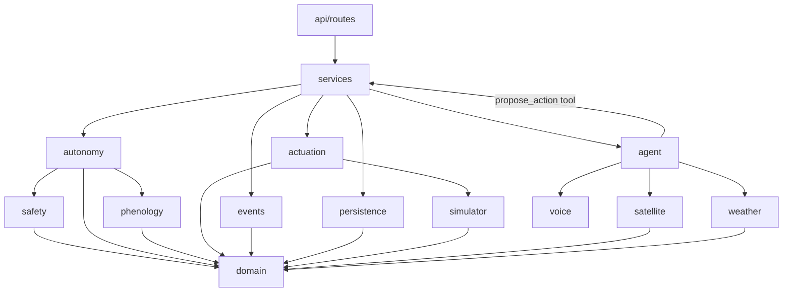
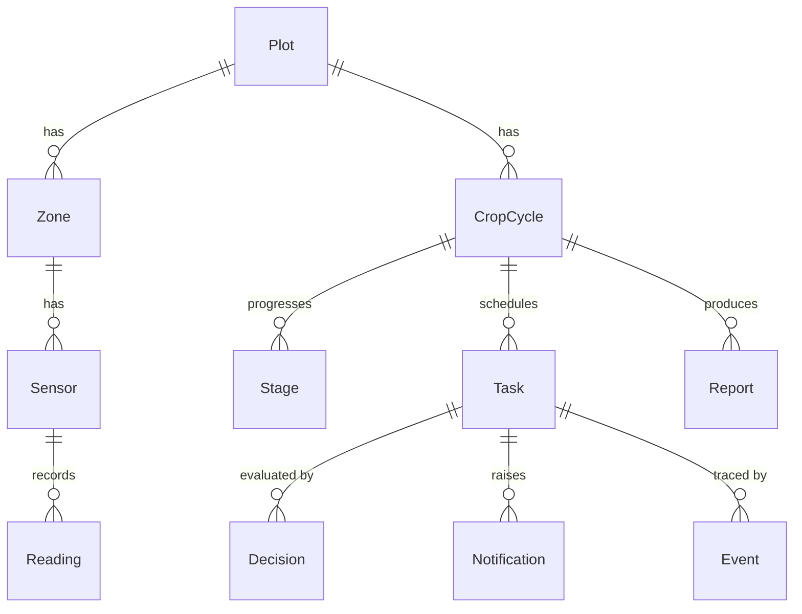

# FieldPilot Architecture

This document defines the module boundaries, their contracts and the data
model. Code must follow it. Changes to this file need explicit confirmation
and, when they resolve an ambiguity, an entry in [`decisions.md`](decisions.md).

Contracts are written as Python signatures. They describe intent, not final
spelling; small renames during implementation are fine as long as the
responsibilities and dependency directions stay the same.

---

## 1. Principles

1. **The LLM proposes; it never actuates.** Agent tools can only create
   `ProposedAction`s. The `Actuator` is never handed to the agent layer.
2. **One path to execution.** Every action goes through
   `ProposalService` → `AutonomyGate.evaluate()` → `Actuator.execute()`.
   Nothing else calls the actuator.
3. **Pure core, I/O at the edges.** Safety rules, autonomy resolution,
   phenology math and NDVI are pure functions over value objects. Database,
   HTTP, files and the clock are reached through interfaces (`Protocol`s) and
   injected.
4. **Dependencies point inward.** `api → services → (autonomy, safety,
   phenology, actuation, agent…) → domain`. `domain` imports nothing from
   the app.
5. **Config, not code.** Autonomy levels (`config/autonomy.yaml`), safety
   limits (`config/safety.yaml`, see D001) and crop data
   (`config/crops/*.yaml`) are loaded once at startup, validated, and passed
   on as immutable objects.
6. **Everything is an event.** Every proposal, verdict, execution, revert,
   approval and rejection is appended to the event log with its inputs, the
   level and rule that applied, and a human-readable reason.
7. **Time is injected.** Domain code never calls `datetime.now()`. It
   receives a `Clock`. The simulator provides an accelerated one. All
   timestamps are timezone-aware UTC.
8. **No global mutable state.** Dependencies are built in
   `app/container.py` and passed explicitly. Runtime state such as the
   emergency stop lives in the database.

---

## 2. Layering



The agent package depends on a narrow `ProposalPort` interface, not on
`ProposalService` directly. Proposals reach the gate, but the agent cannot
reach the actuator.

---

## 3. Core domain types (`app/domain`)

```python
class AutonomyLevel(StrEnum):      # ordered by strictness
    AUTONOMOUS = "autonomous"
    NOTIFY = "notify"
    APPROVAL = "approval"

def strictest(*levels: AutonomyLevel) -> AutonomyLevel: ...

class ActionType(StrEnum):
    IRRIGATION = "irrigation"
    EXTRA_IRRIGATION = "extra_irrigation"
    STOP_IRRIGATION = "stop_irrigation"
    STRESS_ALERT = "stress_alert"
    STAGE_REPORT = "stage_report"
    CALENDAR_SHIFT = "calendar_shift"
    SCOUTING_VISIT = "scouting_visit"
    FERTILIZER = "fertilizer"
    AGROCHEMICAL = "agrochemical"
    PLANTING_DATE_CHANGE = "planting_date_change"
    HARVEST_TIMING = "harvest_timing"
    PRODUCT_LISTING = "product_listing"
    PRICE_CHANGE = "price_change"
    CHEMICAL_INJECTION = "chemical_injection"   # never executable (D005)

class TaskStatus(StrEnum):
    PENDING_APPROVAL = "pending_approval"
    SCHEDULED = "scheduled"      # committed, waiting for scheduled_for
    EXECUTED = "executed"        # physically applied or completed
    REVERTED = "reverted"
    REJECTED = "rejected"
    FAILED = "failed"

class GateOutcome(StrEnum):
    EXECUTE = "execute"                    # AUTONOMOUS
    EXECUTE_AND_NOTIFY = "execute_notify"  # NOTIFY
    AWAIT_APPROVAL = "await_approval"      # APPROVAL (requested or downgraded)

@dataclass(frozen=True)
class ProposedAction:
    action_type: ActionType
    plot_id: int
    zone_id: int | None
    scheduled_for: datetime
    params: Mapping[str, float | str]   # e.g. {"volume_mm": 15}, {"shift_days": 3}
    rationale: str                      # agent's explanation, shown to farmer
    estimated_cost: Money | None
    proposed_by: str                    # "agent:irrigation", "farmer", "system"
    proposal_key: str                   # derived from content, see proposal_key() (D023)

def proposal_key(action_type, plot_id, zone_id, local_day: date, params) -> str: ...
    # sha256 of canonical JSON; excludes rationale, cost and proposer (D023)

class RuleCode(StrEnum):               # English identifiers; Spanish text lives in
    EMERGENCY_STOP_ACTIVE = ...         # config/messages/es.yaml, keyed by code
    ALWAYS_APPROVAL_TYPE = ...
    DAILY_IRRIGATION_CAP_EXCEEDED = ...
    RAIN_FORECAST_ABOVE_LIMIT = ...
    IRRIGATION_INTERVAL_TOO_SHORT = ...
    MOISTURE_ABOVE_LIMIT = ...
    CALENDAR_SHIFT_TOO_LARGE = ...
    MISSING_INPUT = ...                 # a rule lacked data it needs (D027)

@dataclass(frozen=True)
class RuleViolation:
    code: RuleCode
    params: Mapping[str, float | str]   # the numbers behind it, no text

@dataclass(frozen=True)
class GateVerdict:
    outcome: GateOutcome
    requested_level: AutonomyLevel      # default, tightened by the stage (D006)
    effective_level: AutonomyLevel      # after the always-approval check and rules
    violations: tuple[RuleViolation, ...]
    reason_code: RuleCode | None        # emergency_stop_active first (D022), then
                                        # always_approval_type, then the first rule violation
```

---

## 4. Module contracts

### 4.1 Safety (`app/safety/`): pure rules, mypy strict

`rules.py` holds pure functions only: no I/O, no clock, no database. Each
rule takes the proposal, a `SafetyContext` snapshot and the `SafetyLimits`,
and returns `RuleViolation | None`. Loading the limits from YAML lives in
`limits.py`, so the rules never touch a file.

```python
@dataclass(frozen=True)
class SafetyLimits:                       # config/safety.yaml (D001)
    max_irrigation_mm_per_zone_day: float # 20
    rain_skip_threshold_mm_24h: float     # 5
    min_irrigation_interval_hours: float  # 12
    max_moisture_pct_fc: float            # 85
    max_calendar_shift_days: float        # 2 (D026)

@dataclass(frozen=True)
class SafetyContext:                      # built by the caller, read-only snapshot
    emergency_stop_active: bool           # from ControlState
    irrigated_mm_on_day: float            # executed + scheduled, same zone, day of scheduled_for
    last_irrigation_at: datetime | None
    soil_moisture_vwc: float | None       # raw sensor value, volumetric %
    field_capacity_vwc: float | None      # the rule converts with pct_of_field_capacity (D015)
    rain_forecast_mm_24h: float | None

def check_emergency_stop(a, ctx, limits) -> RuleViolation | None: ...   # scope: D022
def check_daily_irrigation_cap(a, ctx, limits) -> RuleViolation | None: ...
def check_rain_forecast(a, ctx, limits) -> RuleViolation | None: ...
def check_irrigation_interval(a, ctx, limits) -> RuleViolation | None: ...
def check_moisture(a, ctx, limits) -> RuleViolation | None: ...
def check_calendar_shift(a, ctx, limits) -> RuleViolation | None: ...

ALL_RULES: tuple[Rule, ...]
def evaluate_rules(a, ctx, limits) -> tuple[RuleViolation, ...]: ...   # every violation, not the first

def load_safety_limits(path: Path) -> SafetyLimits: ...                 # limits.py; ConfigError on any problem
```

**Boundary convention.** A value **equal** to a limit is allowed, and only
values strictly above it violate. These pairs are tested:

| Limit | Allowed | Violation |
|---|---|---|
| Daily irrigation cap | 20 mm | 20.01 mm |
| Forecast rain | 5 mm | 5.01 mm |
| Irrigation interval | 12 h | 11 h 59 min (below the minimum) |
| Moisture | 85 % FC | 85.01 % FC |
| Calendar shift | 2 days | 3 days |

**Which rules apply to which actions:**

- **Irrigation rules** (cap, rain, interval, moisture) apply to
  `irrigation` and `extra_irrigation`.
- **The calendar rule** applies to `calendar_shift`,
  `planting_date_change` and `harvest_timing`, through `params.shift_days`.
- **The emergency stop** follows D022.

**Details:**

- The interval is measured from the proposal's `scheduled_for`, not from
  "now", so a next-day irrigation (D009) is judged at its own time.
- Missing data that a rule needs is itself a violation, `missing_input`
  (D027).

### 4.2 Autonomy (`app/autonomy/`): mypy strict

```python
MANDATORY_APPROVAL: frozenset[ActionType]   # fixed in code (D005); the YAML list must match it

@dataclass(frozen=True)
class AutonomyPolicy:                     # config/autonomy.yaml
    defaults: Mapping[ActionType, AutonomyLevel]   # every ActionType required (D025)
    always_approval: frozenset[ActionType]
    revert_window_seconds: int            # stored now, used in step 6 (D010, D011)
    def default_level(self, action_type: ActionType) -> AutonomyLevel: ...

def load_autonomy_policy(path: Path) -> AutonomyPolicy: ...   # ConfigError on any problem
def validate_stage_overrides(policy: AutonomyPolicy, catalog: CropCatalog) -> None: ...

@dataclass(frozen=True)
class GateContext:
    safety: SafetyContext
    stage_level: AutonomyLevel | None     # StageSpec.level_for(action_type)

class AutonomyGate:
    def __init__(self, policy: AutonomyPolicy, limits: SafetyLimits) -> None: ...
    def evaluate(self, action: ProposedAction, context: GateContext) -> GateVerdict: ...

class MessageCatalog:                     # config/messages/es.yaml, every RuleCode required
    def render(self, code: RuleCode, params: Mapping[str, float | str]) -> str: ...
```

`evaluate` is pure and deterministic. It runs in this order:

1. `default = policy.default_level(type)`.
2. `requested = strictest(default, stage_level)`. A stage mapping can
   only tighten (D006).
3. If the type is in `always_approval`, the result is `APPROVAL` with
   `always_approval_type`. The rules still run and their violations are
   listed too.
4. `violations = evaluate_rules(...)`. The emergency stop runs first
   (D022). Any violation sets the effective level to `APPROVAL` and lists
   all violations.
5. Otherwise the effective level is `requested`.
6. The level maps to the outcome: `AUTONOMOUS → EXECUTE`,
   `NOTIFY → EXECUTE_AND_NOTIFY`, `APPROVAL → AWAIT_APPROVAL`.

There is no "drop" outcome (D004).

**Recording.** The gate does not log, so it stays pure.
`services/gate_decisions.py` (`record_verdict`) writes one `gate_verdict`
event. The event holds the proposal, the context snapshot, the requested
and effective levels, every violation code with its parameters, and the
reason code. Its idempotency key is the proposal key. A second verdict for
the same key is refused by `UNIQUE(kind, idempotency_key)`, and the service
returns the existing one (D023). No new event kind is added.

```python
@dataclass(frozen=True)
class RecordedVerdict:
    verdict: GateVerdict
    already_decided_at: datetime | None   # set when the key was already decided (D023)

def record_verdict(uow, clock, action: ProposedAction, context: GateContext,
                   verdict: GateVerdict) -> RecordedVerdict: ...
```

When `already_decided_at` is set, the reply shows the earlier verdict with
the label "Ya decidida el {fecha}".

**Startup.** `create_app()` loads `autonomy.yaml`, `safety.yaml`, the crop
catalog (with `max_moisture_pct_fc` from `safety.yaml`) and the message
catalog. It refuses to start if any of these holds:

- a mandatory-approval type is below `approval`, or is missing from the
  YAML list (D005);
- an action type has no level (D025);
- `safety.yaml` is incomplete, has unknown keys or has negative values;
- a stage override relaxes a default; an override equal to the default
  is allowed;
- a `RuleCode` has no Spanish message.

### 4.3 Proposal service (`app/services/proposals.py`)

The only orchestrator of the execution path. It implements `ProposalPort`
for the agent.

```python
class ProposalPort(Protocol):
    def propose(self, action: ProposedAction) -> ProposalResult: ...

class ProposalService(ProposalPort):
    def propose(self, action) -> ProposalResult:
        # 1. build SafetyContext (repositories, forecast, clock, emergency flag)
        # 2. verdict = gate.evaluate(...)
        # 3. one transaction: Task (PENDING_APPROVAL or SCHEDULED) + PROPOSAL
        #    event, Decision row + GATE_VERDICT event
        # 4. if EXECUTE / EXECUTE_AND_NOTIFY: run the write-ahead execution below
        #    EXECUTE_AND_NOTIFY -> Notification with revert_deadline
        # 5. return ProposalResult(task, verdict)
```

**Write-ahead execution (D013).** Physical side effects cannot share a
database transaction, so every execution follows three steps:

1. **Transaction A:** append `execution_requested` with a fresh
   `idempotency_key` (`task-{id}:attempt-{n}`), then commit.
2. Call `actuator.execute(task, idempotency_key)`.
3. **Transaction B:** `tasks.transition(..., EXECUTED, execution event)`,
   using the same key and the real result (for example `applied_mm`). On
   failure, the task moves to `FAILED` with an `execution_failed` event that
   carries the same key.

At startup, `reconcile_executions()` reads
`events.find_unclosed_execution_requests()` and decides by key, never by
event kind alone:

- If `actuator.lookup(key)` finds the command was applied, the service
  writes the closing `execution` event with that result and does not retry.
- If the actuator has no record of the key, the task moves to `FAILED`, the
  farmer is notified, and nothing is retried automatically.

A restart therefore never irrigates twice, and never irrigates late without
a new decision.

Related use cases in `app/services`:

- `approve_task(task_id, actor)` re-checks the emergency stop only, then
  executes and logs `APPROVAL` and `EXECUTION`.
- `reject_task(task_id, actor, reason)` logs `REJECTION`.
- `revert_task(task_id, actor)` follows D007.
- `set_emergency_stop(active, actor)`.

### 4.4 Actuation (`app/actuation`)

```python
class Actuator(Protocol):
    def execute(self, task: Task, idempotency_key: str) -> ExecutionResult: ...
    def lookup(self, idempotency_key: str) -> ExecutionResult | None: ...
    def revert(self, task: Task) -> RevertResult: ...   # carries applied_mm (D007)

class SimulatedActuator(Actuator):        # drives FieldSimulator valves
```

The actuator refuses to execute while the emergency stop is active. This is
a defense in depth on top of the gate. Only physical action types are
supported: irrigation, stop irrigation and calendar shift. Fertilizer and
agrochemical tasks, once approved, become manual tasks for the farmer. The
actuator never runs them. Chemical injection has no command (D005).

### 4.5 Event log (`app/events`)

Storage is `EventRepository` (§4.10). `app/events` holds the builders that
turn domain facts into events with a human-readable reason, so wording is
consistent across services.

```python
class EventRepository(Protocol):
    def append(self, event: Event) -> Event: ...
    def list(self, task_id: int | None = None, kind: EventKind | None = None) -> Sequence[Event]: ...
    def find_unclosed_execution_requests(self) -> Sequence[Event]: ...
    def find_by_key(self, kind: EventKind, idempotency_key: str) -> Event | None: ...  # D023
```

The log is append-only: no updates and no deletes. It is the only logging
channel for decisions, and the code has no `print` statements.
`execution_requested` events must carry an idempotency key, and
`(kind, idempotency_key)` is unique.

### 4.6 Simulator (`app/simulator`)

```python
class Clock(Protocol):
    def now(self) -> datetime: ...                 # aware UTC

class SimClock(Clock):                             # pure; wall time is injected
    def __init__(self, state: SimClockState, wall: Callable[[], datetime]) -> None: ...
    def pause(self) -> bool: ...                   # each returns True only if it changed something
    def resume(self) -> bool: ...
    def set_speed(self, factor: float) -> bool: ... # factor > 0
    def advance(self, delta: timedelta) -> bool: ...# delta >= 0; zero is a no-op
    state: SimClockState                           # re-based anchors, ready to persist

class SensorSource(Protocol):
    def read(self, zone_id: int, at: datetime) -> ZoneSnapshot: ...

class ValveController(Protocol):
    def open(self, zone_id: int, target_mm: float, rate_mm_per_h: float, at: datetime) -> None: ...
    def close(self, zone_id: int, at: datetime) -> float: ...   # mm actually applied (D007)
    def status(self, zone_id: int, at: datetime) -> ValveStatus: ...

class Scenario(Protocol):                          # DroughtScenario, HeavyRainScenario
    name: str; start: datetime; end: datetime
    def apply(self, weather: IntervalWeather, start: datetime, end: datetime) -> IntervalWeather: ...

class FieldSimulator(SensorSource, ValveController):
    def advance_to(self, at: datetime) -> None: ... # whole 15-min substeps on a fixed grid
    def inject(self, scenario: Scenario) -> None: ...
    def active_scenarios(self, at: datetime) -> tuple[Scenario, ...]: ...
```

`SimClock` computes `sim_anchor + (wall − wall_anchor) × speed`, or returns
`sim_anchor` while paused. Every operation re-anchors first, so `now()` has
no jumps and never moves backwards. `services/clock.py` persists the state
and logs every effective change as a `clock_changed` event. A no-op writes
nothing.

The physics in `water_balance.py` is pure. Rain and irrigation add water;
ET (ET₀ × Kc) removes it. Excess above field capacity drains, computed from
the content at the start of each substep. The content stays between the
wilting point and saturation.

**Determinism.** Three rules keep the simulator deterministic:

- The integration grid is anchored at the start time, so one `advance_to`
  call gives the same result as many.
- Irrigation is accounted exactly per run (rate × elapsed time, capped at
  the target), independent of the grid.
- Sensor noise is seeded from (seed, zone, grid time), so neither reading
  history nor call pattern changes any value.

**Time guards.** Time never goes backwards, and a scenario cannot start in
the already-simulated past.

**State.** The actuator (step 6) depends only on `ValveController`. The
simulator's state lives in memory (D014). `services/simulation.py` records
readings and logs `scenario_injected` events.

### 4.7 Phenology (`app/phenology`)

```python
@dataclass(frozen=True)
class StageSpec:
    name: str
    display_name: Mapping[str, str]                  # {"en": ..., "es": ...}
    gdd_start: float                                 # °C·day
    kc_start: float; kc_end: float                   # FAO-56 Kc, linear within the stage
    moisture_target: MoistureTarget                  # low/high, % of field capacity
    nutrient_need_kg_ha: Mapping[str, float]         # e.g. {"N": 60}
    autonomy: Mapping[ActionType, AutonomyLevel]     # may only tighten (D006)
    sources: Mapping[str, str]                       # field -> source key
    def level_for(self, action_type: ActionType) -> AutonomyLevel | None: ...

@dataclass(frozen=True)
class CropSpec:
    name: str
    base_temp_c: float; upper_temp_c: float          # 10 / 30 °C cutoff
    maturity_gdd: float
    stages: tuple[StageSpec, ...]
    sources: Mapping[str, Source]                    # citation, url, verification
    reviewed_by_agronomist: bool
    calibration_note: str

def load_crop_catalog(directory: Path, max_moisture_pct_fc: float) -> CropCatalog: ...
def daily_gdd(t_min: float, t_max: float, crop: CropSpec) -> float: ...
def stage_for(gdd: float, crop: CropSpec) -> StageSpec: ...
def transitions_between(gdd_before: float, gdd_after: float, crop: CropSpec) -> tuple[StageSpec, ...]: ...
def crop_coefficient_at(gdd: float, crop: CropSpec) -> float: ...
def project_stage_dates(gdd: float, today: date, expected_daily_gdd: float, crop: CropSpec) -> Mapping[str, date]: ...
def local_day_window(day: date, utc_offset_hours: float) -> tuple[datetime, datetime]: ...
```

Every function above is pure.

**Catalog validation.** Every numeric field in the YAML names a source
declared in the same file (D017). The loader checks the following and stops
the app at startup if any check fails:

- every source exists;
- stages start at 0 and strictly increase;
- stage names are unique;
- Kc is in [0, 2];
- for moisture, `0 < low < high ≤` the safety limit, which is passed in
  rather than duplicated;
- base temperature is below the upper temperature;
- maturity comes after the last stage starts.

**Daily update.** `services/phenology.py` (`PhenologyService.update_cycle`)
counts one finished **local** day (D018):

1. It takes the minimum and maximum temperature from that day's readings.
2. It adds the day's GDD to the cycle.
3. For each stage crossed, it closes the open `Stage`, opens the next one,
   and logs a `stage_transition` event.

All of this runs in one transaction. The update is idempotent through
`CropCycle.gdd_updated_through`. A day without data raises
`MissingDataError` and writes nothing. The next day with data counts only
itself and logs a `phenology_gap` event that lists the skipped days (D019).

### 4.8 Agent (`app/agent`)

```python
class LLMClient(Protocol):
    def complete(self, messages: Sequence[Message], tools: Sequence[ToolSpec]) -> LLMResponse: ...
# MuseClient(model=settings.muse_agent_model, ...) · MockLLMClient(fixtures_dir)

@dataclass(frozen=True)
class Tool(Generic[In, Out]):
    name: str
    description: str
    input_model: type[In]                 # pydantic model -> JSON schema
    handler: Callable[[In], Out]

class ToolRegistry:
    def register(self, tool: Tool) -> None: ...
    def subset(self, names: Iterable[str]) -> "ToolRegistry": ...
    def call(self, name: str, raw_args: Mapping[str, object]) -> ToolCallRecord: ...

@dataclass(frozen=True)
class Subagent:
    name: str                             # monitoring | irrigation | imaging | reporting
    system_prompt: str
    tool_names: frozenset[str]

class Orchestrator:
    def run(self, user_message: str, plot_id: int) -> AgentResult: ...
    # bounded loop: at most settings.agent_max_steps model calls

@dataclass(frozen=True)
class AgentResult:
    answer: str
    trace: tuple[ToolCallRecord, ...]     # name, args, result or error, duration, step
    stopped_by_step_limit: bool
```

Only the Irrigation subagent holds `propose_action`, which calls
`ProposalPort.propose`. The other subagents have read-only tools. The mock
client replays recorded responses keyed by scenario and step, so it is
deterministic.

### 4.9 Satellite, weather and voice

```python
def compute_ndvi(red: NDArray[np.float32], nir: NDArray[np.float32]) -> NDArray[np.float32]: ...
class ImageryLoader: def load(self, plot_id: int, date: date) -> Scene: ...   # data/satellite/
class SegmentationProvider(Protocol):
    def segment(self, image: NDArray[np.uint8], prompt: str) -> Mask: ...
# Sam31Segmentation · MockSegmentation (rectangular mask)

class ForecastProvider(Protocol):
    def rain_next_24h_mm(self, lat: float, lon: float, at: datetime) -> float: ...
# OpenMeteoForecast (httpx) · FixtureForecast (data/fixtures/open_meteo/)

class SpeechToText(Protocol):
    def transcribe(self, audio: bytes, language: str) -> str: ...
# MuseVoiceTranscribe · MockSpeechToText
```

### 4.10 Persistence (`app/persistence`)

The domain uses frozen dataclasses (`app/domain/models.py`) and knows
nothing about storage. SQLModel tables live in `persistence/tables.py`, and
`persistence/mappers.py` converts between the two. Repositories are
`Protocol`s (`persistence/ports.py`) that return domain objects.

```python
class TaskRepository(Protocol):
    def add(self, task: Task, event: Event) -> Task: ...
    def transition(self, task_id: int, target: TaskStatus, event: Event) -> Task: ...

class UnitOfWork(Protocol):        # one session, one transaction
    tasks: TaskRepository; events: EventRepository; ...   # every repository
    def commit(self) -> None: ...   # leaving the block without commit rolls back
```

**What persists and what lives in memory:**

- **Persisted:** every table in §5, including the single-row
  `ControlState` and `SimClockState`.
- **In memory only:** the immutable value objects (`ProposedAction`,
  `SafetyContext`, `GateVerdict`, `RuleViolation`) and the configuration
  loaded from YAML (`SafetyLimits`, `AutonomyPolicy`, `CropSpec`).
- **Rebuilt at startup:** the simulator's internal state, from the latest
  `Reading` of each sensor.
- **Kept through events:** the agent trace, as `agent_tool_call` events.

**Simulated clock.** `SimClock` is an injected object. Its anchor is stored
in `SimClockState`, so a restart never moves time backwards.

**Event before state.** A task's status changes only through
`TaskRepository.add` or `TaskRepository.transition`, both of which require
the event. Inside the caller's unit of work they run in this order:

1. validate the lifecycle (`domain/task_transitions.py`);
2. append the event;
3. write the status.

Any failure rolls back both writes, so there is never a state change
without an event, and never an orphan event. The emergency stop flag
follows the same rule through `ControlStateRepository.set_emergency_stop`.

**Datetimes.** `UTCDateTime` stores naive UTC, because SQLite drops the
offset, and returns aware UTC. It rejects naive input.

**Schema.** The schema is built with `create_all` and has no migrations
(D012).

---

## 5. Data model (SQLite via SQLModel)



| Table | Key fields |
|---|---|
| **Plot** | id, name, latitude, longitude, area_ha, utc_offset_hours (local day, D018), created_at |
| **Zone** | id, plot_id, name, area_ha, field_capacity_pct, valve_id |
| **Sensor** | id, zone_id, kind (`soil_moisture`, `temperature`, `humidity`), unit |
| **Reading** | id, sensor_id, value, recorded_at |
| **CropCycle** | id, plot_id, crop, sowing_date, accumulated_gdd, gdd_updated_through?, status (`active`, `completed`) |
| **Stage** | id, cycle_id, name, started_at, ended_at, gdd_at_start |
| **Task** | id, cycle_id, zone_id?, action_type, params (JSON), scheduled_for, status, effective_level, rationale, estimated_cost_minor?, estimated_cost_currency?, revert_deadline?, created_at, updated_at |
| **Decision** | id, task_id, requested_level, effective_level, outcome, violations (JSON), reason, inputs (JSON snapshot of the `SafetyContext`), created_at |
| **Event** | id, occurred_at (sim clock), kind, actor, task_id?, decision_id?, autonomy_level?, rule?, reason, inputs (JSON), idempotency_key? · unique (kind, idempotency_key) |
| **Notification** | id, task_id?, message, created_at, read_at?, revert_deadline? |
| **Report** | id, cycle_id, stage_id?, language, content (markdown), created_at |
| **ControlState** | id (single row), emergency_stop_active, changed_at, changed_by |
| **SimClockState** | id (single row), sim_anchor, wall_anchor, speed_factor, paused |

Money is stored in minor units (`Money(amount_minor, currency)`) to avoid
float rounding. Every datetime column is aware UTC (§4.10).

`Event.kind` takes one of these values: `proposal`, `gate_verdict`,
`execution_requested`, `execution`, `execution_failed`, `revert`,
`revert_refused`, `approval`, `rejection`, `notification`,
`emergency_stop`, `stage_transition`, `agent_tool_call`, `config_override`,
`clock_changed`, `scenario_injected`, `phenology_gap`.

Task lifecycle (`domain/task_transitions.py`). A task is created as
`pending_approval` or `scheduled`, and these are the allowed transitions:

| From | To |
|---|---|
| `pending_approval` | `scheduled`, `rejected`, `failed` |
| `scheduled` | `executed`, `reverted`, `failed` |
| `executed` | `reverted` (D007) |

`reverted`, `rejected` and `failed` are terminal states.

---

## 6. Configuration files

```yaml
# config/autonomy.yaml
revert_window_seconds: 21600   # 6 h; used in step 6 (D007, D010, D011)
always_approval:               # must equal MANDATORY_APPROVAL in code (D005)
  - fertilizer
  - agrochemical
  - planting_date_change
  - harvest_timing             # named harvest_timing_change in the brief (D024)
  - product_listing
  - price_change
  - chemical_injection         # never implemented; listing it never enables execution
defaults:                      # every action type must appear (D025)
  irrigation: autonomous
  extra_irrigation: notify
  stop_irrigation: autonomous
  stress_alert: autonomous
  stage_report: autonomous
  calendar_shift: notify
  scouting_visit: notify
  fertilizer: approval
  agrochemical: approval
  planting_date_change: approval
  harvest_timing: approval
  product_listing: approval
  price_change: approval
  chemical_injection: approval
```

```yaml
# config/safety.yaml
max_irrigation_mm_per_zone_day: 20
rain_skip_threshold_mm_24h: 5
min_irrigation_interval_hours: 12
max_moisture_pct_fc: 85
max_calendar_shift_days: 2     # D026
```

```yaml
# config/messages/es.yaml  (farmer-facing text; English keys, Spanish values)
rules:                         # one entry per RuleCode, all required
  rain_forecast_above_limit: "Pendiente de aprobación por lluvia prevista ({forecast_mm} mm > {limit_mm} mm)"
  emergency_stop_active: "Pendiente de aprobación: parada de emergencia activa"
  # ...
labels:
  already_decided: "Ya decidida el {decided_at}"
```

If any of these files is missing or invalid, the app does not start
(§4.2).

---

## 7. REST API

| Method | Path | Service |
|---|---|---|
| GET | `/health` | — |
| GET/POST | `/plots`, `/zones` | plots |
| GET | `/readings` | readings |
| GET | `/cycles`, `/cycles/{id}` | cycles |
| GET | `/tasks` | tasks |
| POST | `/tasks/{id}/approve` | `approve_task` |
| POST | `/tasks/{id}/reject` | `reject_task` (D008) |
| POST | `/tasks/{id}/revert` | `revert_task` |
| GET | `/events` | event log |
| GET | `/notifications` | notifications |
| GET | `/reports` | reports |
| POST | `/agent/chat` | `Orchestrator.run` (text or audio) |
| POST | `/emergency-stop` | `set_emergency_stop` |

Route handlers parse the request, call one service function and map the
result to a response. They contain no other logic. Domain errors map to HTTP
codes in one place: not found is 404, an invalid state transition is 409,
and an unsupported action is 422.
