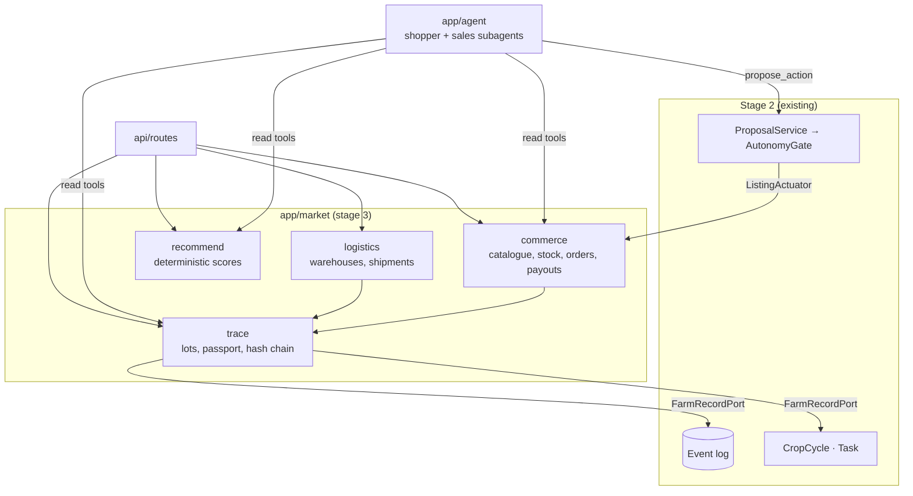
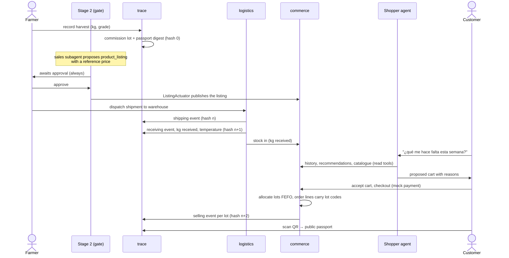
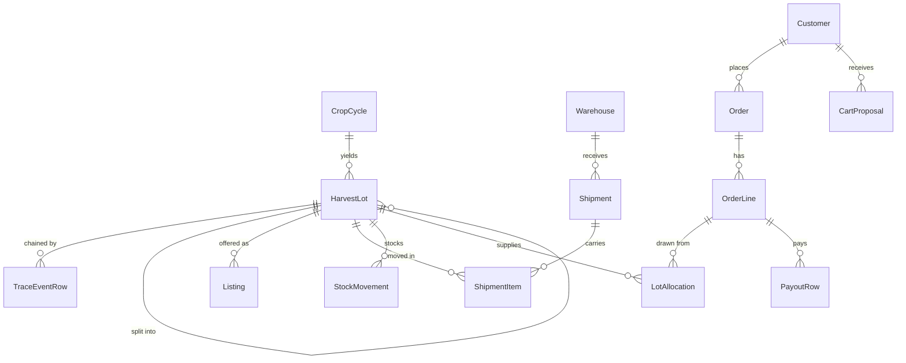

# Stage 3: the direct market (D080)

FieldPilot is one product in three stages: **plan** what to sow (stage 1,
[`planner/`](../planner/README.md)), **automate** the crop (stage 2,
steps 1–11), and **sell** the harvest directly to the people who eat it
(stage 3, this document).

The status is **Proposed**. When D080 is accepted, the contracts below move
into [`architecture.md`](architecture.md) as §4.12 to §4.15, and the tables
into §5.

---

## 1. What stage 3 must do

1. **Turn a harvest into a lot.** The lot carries a passport built from what
   stage 2 recorded: crop, plot area, sowing and harvest dates, water applied
   and inputs applied.
2. **Sell only with the farmer's approval.** A listing and a price change go
   through the existing gate. Both are always `approval` (D005).
3. **Trace every movement:** farm → collection → warehouse → order →
   customer. Quantities are conserved, and every step can be verified.
4. **Run a store** with a catalogue, a cart, orders, a mock payment and a
   purchase record for each customer.
5. **Help each customer shop with an AI agent.** It reads that customer's
   purchase history, predicts what they are about to need, explains where
   the food comes from, and proposes a cart. It never buys on its own.
6. **Pay the farmer transparently.** Every order line shows the share the
   farmer receives.

Out of scope for the hackathon (§12): real payments, real authentication,
a delivery fleet, the regulatory export of trace data, and recalls handled
end to end.

---

## 2. Architecture: a modular monolith

Stage 3 is a new package, `app/market/`, inside the same backend. It shares
the process, the database, the event log, the clock and the agent loop.

| Option | Verdict |
|---|---|
| **Modular monolith** (chosen) | One deploy and one transaction across lot, stock and order. It reuses the gate, the event log and the agent loop. The boundaries are enforced by import rules, so the package can be split out later. |
| Microservices | Distributed transactions between stock and orders, plus three more deploys. Nothing in the hackathon scope needs independent scaling. |
| Blockchain ledger | Tamper evidence is the only property needed, and a per-lot hash chain gives it (§4.3) without a network, gas or keys to manage. The chain heads can be anchored to a public ledger later without changing the model. |



**Dependency rules** (checked by a test that parses imports):
- `app/market` may import `app.domain` (shared value objects such as
  `Money`) and its own ports. It never imports farm services or tables.
- The farm side never imports `app/market`. The one link back is the
  `ListingActuator`, wired in `app/container.py`.
- Stage 2 facts reach the market only through `FarmRecordPort` (§4.2).
- Inside the market, `commerce` and `logistics` depend on `trace`. `trace`
  depends on neither.

**Package layout:**

```
app/market/
  domain/        quantities, lot codes, trace events, order lifecycle (pure, mypy strict)
  trace/         LotService, PassportBuilder, HashChain, FarmRecordPort
  logistics/     ShipmentService, WarehouseService
  commerce/      CatalogService, StockLedger, OrderService, PaymentGateway, PayoutLedger
  recommend/     Recommender and its scorers (pure)
  ports.py       market repositories (Protocols)
config/market.yaml   products, shelf life, fees, recommender weights
config/agents/shopper.md · config/agents/sales.md
```

---

## 3. The journey, end to end



---

## 4. Traceability (`app/market/trace`)

### 4.1 Vocabulary

The model follows **GS1 EPCIS 2.0** and the **Critical Tracking Events /
Key Data Elements** framing of FDA FSMA 204:

| EPCIS concept | Here |
|---|---|
| Event types: Object, Aggregation, Transformation | `TraceEventType`: `object`, `aggregation`, `transformation` |
| `bizStep` | `BizStep`: `commissioning`, `packing`, `shipping`, `receiving`, `storing`, `retail_selling`, `destroying` |
| `readPoint`, `bizLocation` | `Location`: a plot, a warehouse or a customer's delivery zone |
| quantity list | `quantity_g`, an integer number of grams |

Each step stores **who, what, when, where and how much** (the KDEs). With
the same names, a later EPCIS JSON-LD export is a mapping, not a redesign.

### 4.2 The lot and its passport

```python
@dataclass(frozen=True)
class Grams:                           # integer grams, like Money in minor units
    value: int                         # never a float; a negative value raises

@dataclass(frozen=True)
class HarvestLot:
    code: LotCode                      # "FP-<plot>-<yyyymmdd>-<seq>", printed in the QR
    cycle_id: int
    crop: str
    harvested_on: date
    quantity: Grams                    # as weighed at harvest
    grade: str                         # per crop, from config/market.yaml
    parent: LotCode | None             # set when a lot is split at packing

class FarmRecordPort(Protocol):        # implemented over the farm repositories
    def cycle_record(self, cycle_id: int) -> CultivationRecord: ...

@dataclass(frozen=True)
class CultivationRecord:               # facts already recorded by stage 2
    crop: str; plot_area_ha: float; municipality: str
    sowing_date: date; harvest_date: date
    irrigation_mm_total: float; irrigation_events: int
    inputs_applied: tuple[InputApplication, ...]   # executed fertilizer/agrochemical tasks
    source_event_ids: tuple[int, ...]
    source_digest: str                 # sha256 of the canonical JSON of those events
```

`PassportBuilder` puts the `CultivationRecord` together with the lot's trace
events. A passport is a read model: it is never stored, only rebuilt.

**Public and private fields.** The public passport, behind the QR code,
shows the following:
- the crop and the municipality;
- the sowing and harvest dates;
- the water applied and the inputs applied, with their dates;
- the warehouse and the receipt date;
- the integrity check.

It never shows the plot's coordinates, sensor readings or prices.

**The farmer's name is opt-in.**
- **By default**, the passport says "Productor de <municipio>". With the
  farmer's coordinates hidden, that cannot be traced back to a person.
- **With consent**, it shows the name the farmer chose: their own, their
  farm's, or their association's.
- **Recording consent.** It is asked once, in plain words, and recorded
  with its date (`Producer.public_name_consent_at`). The farmer can revoke
  it at any time, and the passport stops showing the name on the next read.
  Because passports are rebuilt, nothing old keeps it.

There are three reasons:
- **The law.** A name tied to a place and an income is personal data under
  Ley 1581 de 2012, and needs prior, express authorisation.
- **Safety.** Publishing who sells what, where and when can expose rural
  producers to extortion.
- **The story.** "Lo cultivó María en La Plata" sells, so the farmers who
  want it can have it.

### 4.3 Tamper evidence: one hash chain per lot

```python
@dataclass(frozen=True)
class TraceEvent:
    lot: LotCode; seq: int             # 0 = commissioning
    event_type: TraceEventType; biz_step: BizStep
    occurred_at: datetime              # aware UTC, from the injected clock
    location: Location; actor: str
    quantity: Grams
    data: Mapping[str, JsonValue]      # temperature_c, shipment_id, order_id, source_digest…
    prev_hash: str                     # seq 0: the parent lot's head hash, or 64 zeros
    hash: str                          # sha256(prev_hash ‖ canonical_json(body))

def verify_chain(events: Sequence[TraceEvent]) -> ChainCheck: ...   # pure
```

- The commissioning event holds `source_digest`. If the stage-2 event log
  were edited later, the passport would no longer verify.
- A split at packing starts each child lot's chain from the parent's head
  hash. The lots form a DAG, as git commits do, so each one can be verified
  on its own.
- `TraceRepository` only appends. `(lot, seq)` is unique.

**Invariant: quantities are conserved.** For every lot:

```
commissioned
  − sum(shipped − received)    (shrinkage in transit)
  − sum(destroyed)
  − sum(sold)
  − sum(packed into children)
  = on hand ≥ 0
```

`LotService` checks this before it appends anything that removes
quantity. A violation raises `QuantityConservationError`, which returns 409.

### 4.4 Backward and forward trace

- **Backward (customer → farm):** `order line → lot → parent lots →
  CultivationRecord`. This feeds the passport.
- **Forward (lot → customers):** `lot and its children → order lines →
  orders`. This answers "who received lot X?", the core of a recall. The
  query ships in the hackathon slice; the recall workflow comes later.

---

## 5. Logistics (`app/market/logistics`)

```python
@dataclass(frozen=True)
class Warehouse:
    id: int; name: str; municipality: str
    cold_storage: bool

class ShipmentStatus(StrEnum):
    PLANNED = "planned"; DISPATCHED = "dispatched"
    RECEIVED = "received"; REJECTED = "rejected"

class ShipmentService:
    def plan(self, lots: Sequence[tuple[LotCode, Grams]], to: int, carrier: str) -> Shipment: ...
    def dispatch(self, shipment_id: int) -> Shipment: ...          # shipping event per lot
    def receive(self, shipment_id: int, received: Mapping[LotCode, Grams],
                temperature_c: float | None, grade_ok: bool) -> Shipment: ...
    # receiving event per lot; stock in = kg received; the gap is shrinkage
```

| From | To |
|---|---|
| `planned` | `dispatched` |
| `dispatched` | `received`, `rejected` |

- **Received ≤ dispatched.** The difference is recorded as shrinkage, with
  its reason.
- **Cold chain.** A product's `max_storage_c` (in `config/market.yaml`) is
  compared with the temperature recorded at receiving. An excursion is
  written to the receiving event and flags the lot; it does not block the
  receipt.
- **Shelf life.** `best_before = harvested_on + shelf_life_days`, with the
  value per product. Stock is allocated **FEFO** (first expired, first out).
- **The demo has one warehouse**, seeded. Nothing in the model assumes
  there is only one: stock, shipments and allocations all carry a
  `warehouse_id`.
- In the demo, a warehouse operator's actions are two buttons: dispatch and
  receive. Sensors in the trucks come later.

---

## 6. Commerce (`app/market/commerce`)

### 6.1 Catalogue, listing and price

A **product** is what the customer buys, for example "Tomate chonto · 1 kg".
A **listing** is a farmer's offer of a lot as that product, at a price.

```python
@dataclass(frozen=True)
class Product:                         # from config/market.yaml
    sku: str; name_es: str; crop: str
    unit: Grams                        # 1 kg, 500 g…
    shelf_life_days: int; max_storage_c: float | None
    category: str

@dataclass(frozen=True)
class Listing:
    id: int; lot: LotCode; sku: str
    farmer_price: Money                # per unit, approved by the farmer
    status: ListingStatus              # active | paused | sold_out

@dataclass(frozen=True)
class MarketFees:                      # config/market.yaml
    logistics_per_kg: Money            # demo_value: COP 300 per kg
    platform_pct: float                # demo_value: 5 % of the farmer price
    min_farmer_share_pct: float        # 80; a listing below it is refused

def shelf_price(farmer_price: Money, unit: Grams, fees: MarketFees) -> PriceBreakdown: ...   # pure
# PriceBreakdown(farmer, logistics, platform, total, farmer_share_pct)
```

**The fees are kept low on purpose, and they are example values.** Both are
labelled `demo_value` in the YAML, as D038 does for the irrigation rate. A
real deployment sets them from real costs.

**A worked example:** tomato at COP 3,000 per kg to the farmer.

| Part | COP per kg |
|---|---|
| Farmer | 3,000 |
| Logistics | 300 |
| Platform (5 % of 3,000) | 150 |
| **Price on the shelf** | **3,450** |

The farmer receives 87 % of the shelf price.

`min_farmer_share_pct` is a guard in code. If a cheap product's fixed
logistics fee would leave the farmer under 80 %, the listing is refused
with a reason and is never silently published.

**A listing goes through the gate.** No new path to execution is added
(principle 2):
1. After a harvest, the `sales` subagent proposes a `product_listing` with a
   `{lot, sku, farmer_price}` payload. The reference price comes from DANE
   SIPSA wholesale prices; in the demo it is a fixture, and the source is
   verified when that step is built.
2. The type is always `approval`, so the farmer approves it in the
   dashboard.
3. `ExecutionService` hands the permit to the actuator. An
   **`ActuatorRouter`** sends `product_listing` and `price_change` to
   `ListingActuator`, which publishes or reprices the listing. Irrigation
   still goes to `SimulatedActuator`.

This needs a small contract change, specified in architecture.md once
D080 is accepted:
- **`Actuator` is split** into `Actuator` (`execute`, `lookup`) and
  `ValveControl` (`interrupt`, `close_valve`). This is interface
  segregation: a listing has no valve.
- **`ExecutionResult` gains `reference: str | None`**, the listing id. Its
  irrigation fields become optional.

### 6.2 Stock

`StockLedger` is append-only. Every row is a movement of
`(warehouse, lot, sku, delta_units, reason, ref)`, where the reason is
`receipt`, `reservation`, `release`, `sale` or `shrinkage`. Stock is the
sum of the movements; no counter is ever updated in place. A reservation
and its order are written in the same transaction.

### 6.3 Customers, orders and the purchase record

```python
class OrderStatus(StrEnum):
    PLACED = "placed"; PAID = "paid"; PICKED = "picked"
    DELIVERED = "delivered"; CANCELLED = "cancelled"

@dataclass(frozen=True)
class OrderLine:
    sku: str; units: int
    unit_price: PriceBreakdown          # frozen at checkout
    allocations: tuple[LotAllocation, ...]   # (lot, units): FEFO across lots

class OrderService:
    def checkout(self, customer_id: int, cart: Cart) -> Order: ...
    # reprices from the active listings, so a stale cart is shown again;
    # allocates FEFO; reserves stock; asks PaymentGateway; one transaction
    def advance(self, order_id: int, to: OrderStatus) -> Order: ...

class PaymentGateway(Protocol):        # MockPaymentGateway for the demo
    def charge(self, order_id: int, amount: Money, idempotency_key: str) -> PaymentResult: ...
```

| From | To |
|---|---|
| `placed` | `paid`, `cancelled` (the reservation is released) |
| `paid` | `picked`, `cancelled` (refund through the gateway) |
| `picked` | `delivered` (a `retail_selling` trace event per allocation) |

**Any customer can buy.** A household, a restaurant or a shop is the same
`Customer` with a `kind` (`household` or `business`). In the demo, every
kind sees the same catalogue and the same prices. Business features come
later without changing the order model:
- a tax id (NIT) on the invoice;
- volume prices;
- recurring orders.

**The purchase record for each customer.** It is the customer's own orders
and order lines, which are never deleted. A refund is a new movement, not
an edit. The recommender reads from them a derived **`PurchaseProfile`**:

```python
@dataclass(frozen=True)
class ProductHabit:
    sku: str; orders: int; units_total: int
    last_bought: date
    median_interval_days: float | None  # None below two purchases
    usual_units: int                    # median units per order

@dataclass(frozen=True)
class PurchaseProfile:
    customer_id: int; habits: tuple[ProductHabit, ...]
    basket_median: Money; orders_count: int
```

The profile is computed from the orders, not stored as a second truth.
For speed it can be cached and rebuilt after every order.

**The farmer's payout.** `PayoutLedger` writes one row per delivered order
line: `(farmer, lot, amount = farmer_price × units)`. The farmer's sales
tab adds these rows up.

---

## 7. The shopping assistant

### 7.1 The recommender is deterministic; the LLM explains

What a customer needs is predicted by **pure, explainable scorers**. The
LLM never invents numbers. It calls tools and explains their reasons in
Spanish. With no real purchase data, a trained model has nothing to learn
from (§12); the scorers can run from the first order.

| Scorer | Signal | Score |
|---|---|---|
| `ReplenishmentScorer` | Days since the last purchase against the customer's median interval (≥ 2 purchases) | `min(days_since / median_interval, 2)`, counted only above `due_ratio` (0.8) |
| `CoPurchaseScorer` | Item-item cosine over the customer × product purchase matrix, across all customers | Σ similarity to the customer's recent products |
| `FreshHarvestScorer` | Lots in stock harvested ≤ `fresh_days` ago | `1 − age / fresh_days` |
| `PopularityScorer` | Units sold in the last 30 days (cold start) | Normalised rank |

```python
@dataclass(frozen=True)
class Recommendation:
    sku: str; score: float
    suggested_units: int               # usual_units, or 1
    reasons: tuple[ReasonCode, ...]    # REPURCHASE_DUE, BOUGHT_TOGETHER, FRESH_HARVEST, POPULAR
    evidence: Mapping[str, JsonValue]  # e.g. {"last_bought": "2026-10-20", "median_interval_days": 7}

class Recommender:
    def __init__(self, scorers: Sequence[Scorer], weights: Mapping[str, float]) -> None: ...
    def recommend(self, profile: PurchaseProfile, stock: StockView, k: int) -> tuple[Recommendation, ...]: ...
```

- A new scorer is a new class; `Recommender` does not change (open/closed).
- Only SKUs in stock are ranked.
- The weights live in `config/market.yaml`.
- **Evaluation**, once real orders exist: hit rate@k and NDCG@k on each
  customer's next order (a time split). A learned ranker replaces the
  weights only if it wins, the same rule as B0 in stage 1.

### 7.2 The `shopper` subagent

It reuses `AgentLoop`, `LLMClient`, `ToolRegistry` and the trace. Its
prompt is `config/agents/shopper.md`.

| Tool | Writes | Returns |
|---|---|---|
| `get_purchase_history(limit)` | no | The customer's last orders and `PurchaseProfile` habits |
| `get_recommendations(k)` | no | `Recommendation`s with reasons and evidence |
| `search_catalog(query, category?)` | no | Products in stock, with `PriceBreakdown` |
| `get_passport(sku \| lot_code)` | no | The public passport of the lot that would be allocated |
| `propose_cart(items, note)` | yes (`may_write`) | A `CartProposal` the customer accepts or edits |

**Guardrails.** Each one is enforced in code, never by the prompt alone:
1. **The customer is bound by the session, not chosen by the model.** The
   tools are built per request with the authenticated `customer_id` in
   their closure. No tool takes a customer id argument, so the model cannot
   read anyone else's history.
2. **It proposes; it never buys** (principle 1). `propose_cart` writes a
   proposal. Only the customer's checkout creates an order, and checkout
   reprices and rechecks stock.
3. **Prices, stock and dates come only from tool output.** The closing
   check rejects an answer that quotes a price not returned by a tool. This
   reuses `app/agent/citations.py`.
4. **No health or nutrition claims.** This is in the prompt, and in a list
   of refused phrases tested with fixtures.
5. Every tool call is an `agent_tool_call` event, as in stage 2.

**Free-text needs.** For example, "voy a hacer sancocho para 6 el
domingo": the model maps the dish to catalogue searches and quantities,
calls `propose_cart`, and says which items came from its reasoning and
which came from the customer's history.

### 7.3 The `sales` subagent (the farmer side)

After a lot is commissioned, the `sales` subagent proposes the
`product_listing`:
- the SKU;
- a price, from the reference price and the farmer's last approved price;
- a rationale.

Later, when stock does not move, it can propose a `price_change`. Both
always wait for the farmer's approval.

### 7.4 Privacy (Colombia, Ley 1581 de 2012)

- Consent is recorded when the customer signs up (`consent_profiling_at`).
  Without it, the assistant uses only popularity and fresh-harvest scores.
- The customer can download their record and delete their profile. The
  order lines stay for tax and trace purposes, detached from the person.
- Customer data never enters the farm's event log or a public passport.

---

## 8. Data model (new tables)



| Table | Key fields |
|---|---|
| **HarvestLot** | code (unique), cycle_id, crop, harvested_on, quantity_g, grade, parent_code?, created_at |
| **TraceEventRow** | id, lot_code, seq, event_type, biz_step, occurred_at, location_kind, location_id, actor, quantity_g, data (JSON), prev_hash, hash · unique (lot_code, seq) |
| **Warehouse** | id, name, municipality, cold_storage |
| **Shipment** | id, warehouse_id, carrier, status, planned_at, dispatched_at?, received_at?, temperature_c? |
| **ShipmentItem** | id, shipment_id, lot_code, dispatched_g, received_g?, shrinkage_reason? |
| **Listing** | id, lot_code, sku, farmer_price_minor, currency, status, task_id (the approved task) |
| **StockMovement** | id, warehouse_id, lot_code, sku, delta_units, reason, ref, occurred_at |
| **Customer** | id, kind (`household`, `business`), display_name, municipality, consent_profiling_at?, created_at |
| **Producer** | id, plot_id, public_name?, public_name_consent_at? (the passport shows the name only while both are set) |
| **Order** | id, customer_id, status, total_minor, currency, placed_at, payment_ref? |
| **OrderLine** | id, order_id, sku, units, farmer_minor, logistics_minor, platform_minor |
| **LotAllocation** | id, order_line_id, lot_code, units |
| **CartProposal** | id, customer_id, items (JSON), note, run_id, status (`open`, `accepted`, `dismissed`), created_at |
| **PayoutRow** | id, order_line_id, lot_code, amount_minor, currency, created_at |

- Money is in minor units and quantities are in integer grams or units.
- Datetimes are aware UTC (§4.10).

**New `Event.kind` values:**
- `lot_commissioned`
- `listing_published`
- `shipment_dispatched`
- `shipment_received`
- `order_placed`
- `order_status_changed`
- `cart_proposed`

Each one points to the trace or the order it belongs to.

---

## 9. REST API (additions)

| Method | Path | Who | Service |
|---|---|---|---|
| POST | `/cycles/{id}/harvest` | farmer | `LotService.commission` (kg, grade) |
| GET | `/lots`, `/lots/{code}` | farmer, operator | lots with stock and chain status |
| GET | `/trace/{code}` | **public** | `PassportBuilder.public`, with `verified: bool` |
| GET | `/warehouses`, POST `/shipments` | operator | `ShipmentService.plan` |
| POST | `/shipments/{id}/dispatch`, `/shipments/{id}/receive` | operator | `ShipmentService` |
| GET | `/store/products?q=&category=` | customer | `CatalogService.search`: in stock, with `PriceBreakdown` |
| GET | `/store/products/{sku}` | customer | product, lot passport summary, farmer share |
| POST | `/store/orders` | customer | `OrderService.checkout` |
| GET | `/store/orders` | customer | **the customer's purchase record** |
| GET | `/store/recommendations?k=` | customer | `Recommender.recommend` |
| POST | `/store/assistant` | customer | `ShopperChatService.ask` |
| POST | `/store/cart-proposals/{id}/accept` | customer | turns a proposal into the cart |
| GET | `/sales` | farmer | listings, sold units and the payout total |

**New errors:**
- 409: `QuantityConservationError`, `OutOfStockError`, `StalePriceError`.
- 402: `PaymentDeclinedError`.

---

## 10. Users, roles and authentication

The API has no authentication today; every request comes from the
farmer's dashboard (`app/api/deps.py`). Stage 3 has four roles: farmer,
warehouse operator, customer and admin.

- **Hackathon:** under `APP_PROFILE=demo`, seeded users are picked from a
  persona switcher. Requests carry a signed session cookie that the server
  issues. Without the demo profile the store routes return 401. This is
  stated as "not authentication" in the README.
- **After:** OpenID Connect through a standard identity provider, with
  role claims checked in one FastAPI dependency per role.

---

## 11. How the three stages connect

| From | To | What flows |
|---|---|---|
| Stage 1 → stage 3 | Supply forecast | Planned sowings and the predicted harvest date and yield become "próximamente" products. Pre-orders come later. |
| Stage 2 → stage 3 | Passport | `CultivationRecord` from the event log, sealed by `source_digest` |
| Stage 2 → stage 3 | Gate | `product_listing` and `price_change` with the farmer's approval |
| Stage 3 → stage 1 | Demand (later) | Sales by product and municipality become a demand feature for the planner's ranking: what to sow that will also sell |

---

## 12. Scope: the hackathon slice and what comes after

The deadline is 2026-11-04. The stage 1 integration and the demo video come
first. Stage 3 ships as one thin vertical slice in mock mode:

| # | Slice | Done when |
|---|---|---|
| 1 | `trace`: harvest → lot, hash chain, `verify_chain`, `/trace/{code}` | Tests: chain tamper fails, conservation holds |
| 2 | Listing through the gate: `ActuatorRouter` and `ListingActuator` | An approved `product_listing` publishes a listing; a rejected one does not |
| 3 | Logistics: dispatch and receive to one warehouse, with shrinkage | Stock equals kg received; trace has both events |
| 4 | Store: catalogue, checkout with the mock gateway, FEFO, the purchase record | An order line carries its lots; `/store/orders` lists them |
| 5 | Recommender (4 scorers) and the `shopper` agent with fixtures | The seeded customer gets REPURCHASE_DUE with evidence; the cart is proposed, not placed |
| 6 | Dashboard: Store and Passport views, and a Sales tab for the farmer | Demo scene recorded |

**Cut first, in this order:**
1. The `sales` subagent. The farmer types the price, and the gate still
   applies.
2. The logistics UI. The steps run through the API, and the seed calls it.
3. The live LLM for the shopper. It replays fixtures.

**Never cut:**
- the gate on listings;
- the hash chain check;
- the per-session customer binding;
- `make check` green.

**After the hackathon:**
- PostgreSQL with Alembic, which concurrent orders and row-locked stock
  need;
- OIDC;
- a real payment gateway;
- the SIPSA price feed;
- cold-chain sensors;
- the EPCIS export;
- the recall workflow;
- delivery;
- a learned ranker, once it beats the scorers;
- demand as a feature for the planner.

---

## 13. Questions resolved by Edwin (2026-11-03)

1. **Buyers:** any customer. `Customer.kind` (§6.3) covers households and
   businesses; they share the catalogue and prices in the demo.
2. **Warehouses:** one in the demo. The model stays multi-warehouse (§5).
3. **The farmer's name on the passport:** opt-in, with revocable consent
   (§4.2).
4. **Fees:** example values, kept low. Logistics is COP 300 per kg and the
   platform takes 5 %, with the farmer's share never under 80 % (§6.1).
