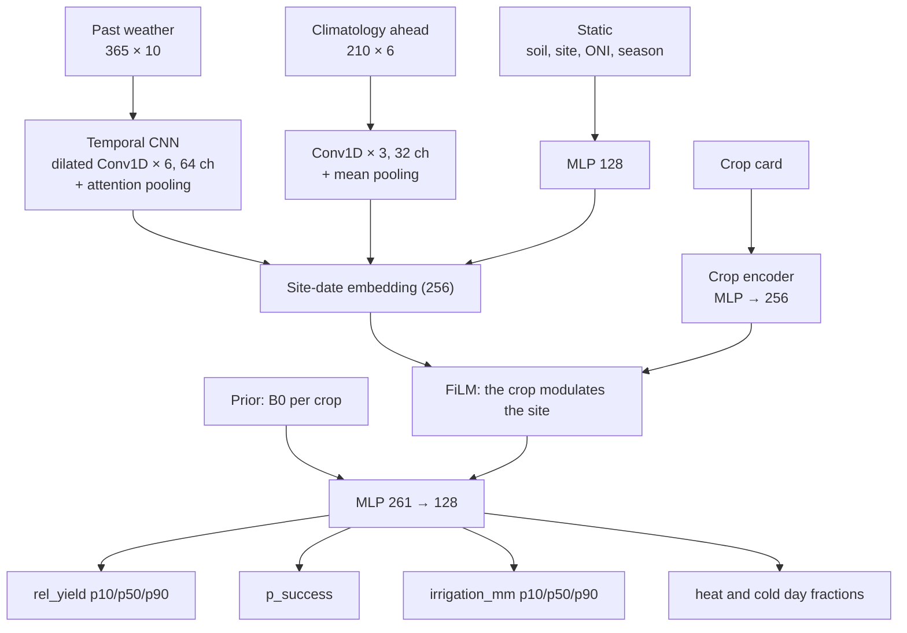

# FieldPilot Planner: stage 1, what to sow and when

- **Written:** 2026-11-02
- **Status:** accepted (D079).
- **Training machine:** NVIDIA RTX 5060 Ti 16 GB (Blackwell, `sm_120`).

FieldPilot is one product in three stages:

1. **Plan (this folder).** Recommend what to sow and when, from the
   climate, the soil and the season ahead.
2. **Automate (`backend/`, `frontend/`).** The agents run the crop that
   was sown: irrigation, imaging, reports and the safety gate.
3. **Sell (future).** A marketplace that buys the harvest directly from
   the farmer, with a traceability record built from the event log.

This document is the training route for stage 1: the question the model
answers, the data, how it is cleaned, how the labels are made, the network,
the training configuration for the RTX 5060 Ti, the evaluation, and how the
result reaches the dashboard.

---

## 1. Reproducible from public data

- **Every dataset is public** and is downloaded by the scripts in this
  folder.
- **Each download is recorded** in a manifest with its date and SHA-256, so
  the dataset can be rebuilt and checked.

---

## 2. The question

> "If I sow crop *c* on this plot on date *d*, how will it go, and how much
> water will it need?"

For each plot, sowing date and crop, the model predicts:

| Output | Meaning |
|---|---|
| `rel_yield_rainfed` p10, p50, p90 | Expected yield relative to the crop's potential (0–1), without irrigation |
| `p_success` | Probability that the rainfed relative yield reaches 0.6 (project convention) |
| `irrigation_mm` p10, p50, p90 | Water needed to avoid water stress over the whole cycle |
| `heat_days`, `cold_days` | Days above the optimal maximum and below the absolute minimum temperature |

It does so using **only what is known on the sowing date**: the last 365 days
of weather, the climatology of the coming months, the El Niño state, the
soil, the site and the crop's published requirements.

The recommendation the farmer sees is a ranking of crops and sowing weeks,
built from these outputs (§9).

---

## 3. Why labels come from an oracle

There is no public dataset that says "crop *c* sown on date *d* on this
plot yielded *y*". The labels are therefore produced by an **agronomic
oracle**: published FAO models run on the weather that **actually
happened** after each sowing date, from 1981 to 2025.

The network learns to anticipate the oracle **without** seeing that future
weather. That is the value it adds: the oracle alone can only score the
past.

This has a consequence that must be stated wherever the result is shown:
**the model is as good as the published crop parameters it was trained on,
and has not been calibrated against real yields** (§7.3 is the check).

---

## 4. Data

### 4.1 Sources

| Source | What | Access | Coverage |
|---|---|---|---|
| **NASA POWER** daily API | T2M, T2M_MAX, T2M_MIN, T2MDEW, RH2M, PRECTOTCORR, WS2M, ALLSKY_SFC_SW_DWN, GWETROOT | Free, no key | 1981-01-01 → 2025-12-31 (radiation from 1984) |
| **Open-Meteo Elevation** | Plot elevation (Copernicus DEM GLO-90) | Free, no key | Static |
| **ISRIC SoilGrids 2.0**, 1 km aggregates | sand, clay, soc, phh2o, bdod, wv0033, wv1500; six depths to 200 cm; mean | Free, no key | Static |
| **NOAA CPC ONI** | Oceanic Niño Index, 3-month running mean | Free | 1950 → today |
| **DIVIPOLA** (DANE, datos.gov.co) | Municipality centroids | Free | Static |
| **EVA** (UPRA / Agronet, datos.gov.co) | Municipal area, production and yield per crop and year | Free | 2006 → 2025 |
| **FAO-56** (Allen et al., 1998) | Kc (Table 12), stage lengths (Table 11), root depth and p (Table 22) | Public | — |
| **FAO-33**, via FAO-56 Table 24 | Seasonal yield response factor Ky | Public | — |
| **FAO ECOCROP** (CRAN package Recocrop 0.4-2) | Absolute and optimal ranges of temperature and pH; killing temperature | Public | — |

Every URL and dataset identifier was verified on 2026-11-02 and is listed
in `configs/sources.yaml`.
- **SoilGrids:** the REST API takes about two minutes per point, so the
  pipeline reads the 1 km rasters once, cropped to Colombia (42 layers, about
  100 s in total).
- **Soil in towns:** SoilGrids has no data in towns, where many municipal
  centroids fall. Each point therefore takes the nearest pixel that has every
  layer, within 10 km; the quality report records how far it moved.

### 4.2 Training points

Points are **municipal centroids** of Colombian municipalities that reported
area for at least one candidate crop in EVA. This choice has two benefits:
- the points sit where farming happens;
- each point has real yields for the calibration check (§7.3).

Rules:
- **One point per POWER cell** (0.5° × 0.625°). Points in the same cell
  would share the same weather and inflate the dataset without adding
  information. The municipality with the largest reported crop area is kept.
- **Stratified by thermal floor** (< 1000 m, 1000–2000 m, > 2000 m) if the
  cap of 260 points is exceeded.
- **Result: 189 points.**
  - By thermal floor: 147 below 1000 m, 23 between 1000 and 2000 m, and 19
    above 2000 m.
  - 7 are in Huila: the spatial holdout of §7.3.
- `configs/points.csv` is generated with a fixed seed and **is versioned**,
  so the dataset can be rebuilt.

### 4.3 Candidate crops

The candidates were ten annual or short-cycle crops grown in Colombia.
**Eight have a complete, sourced card:**
- maize, common bean, sorghum and soybean;
- groundnut, cotton, tomato and potato.

Two were left out:
- **rice:** FAO-56 Table 24 has no Ky for it, and paddy water management is
  not a root-zone bucket;
- **cassava:** FAO-56 gives a two-year cycle, longer than the 210 days the
  planner models.

A crop enters `configs/crops.yaml` only when every field below has a
verified source (as in `config/crops/`, D019). A crop with a missing value
is left out, and the reason is written down.

| Field | Source |
|---|---|
| Killing, absolute and optimal temperature range | ECOCROP |
| pH range | ECOCROP |
| Cycle length and stage fractions (initial, development, mid, late) | FAO-56 Table 11, for the region closest to Colombia |
| Kc ini, mid, end | FAO-56 Table 12 |
| Max root depth Zr, depletion fraction p | FAO-56 Table 22 |
| Seasonal Ky | FAO-56 Table 24 (from FAO-33) |

Stage lengths are **days after sowing**, as published. This is the same
choice D078 makes for the bean; no days are converted into degree-days.

Where a source gives a range (for example, Zr of 1.0–1.7 m), the card keeps
both ends and the code uses the midpoint. This is the only project
convention in the cards.

---

## 5. Cleaning: the cleanest data possible

Each step is a pure function with a unit test. The pipeline writes a
**quality report** per point. A point that fails is excluded and listed
with its reason, never fixed by hand.

| # | Step | Rule |
|---|---|---|
| 1 | Fill values | POWER's `-999` becomes missing |
| 2 | Physical ranges | -10 ≤ T ≤ 50 °C; 0 ≤ rain ≤ 400 mm/day; 0 ≤ RH ≤ 100 %; 0 ≤ wind ≤ 40 m/s. Out of range becomes missing |
| 3 | Consistency | T2M_MIN ≤ T2M ≤ T2M_MAX. Otherwise all three become missing that day |
| 4 | Gaps | Gaps of ≤ 3 days are interpolated linearly (except rain, which is not interpolated). Longer gaps are masked |
| 5 | Exclusion | A point with > 2 % masked days, or with no soil pixel within 10 km, is excluded |
| 6 | Elevation | Temperatures are corrected with −6.5 °C/km × (plot elevation − POWER cell elevation). The dewpoint is not corrected, which is a known small overestimate of ET0 in valleys |
| 7 | Radiation 1981–1983 | Missing in POWER. Radiation is estimated with FAO-56 Eq. 50, ET0 uses Hargreaves (Eq. 52), and a flag marks those days |
| 8 | ET0 | FAO-56 Penman-Monteith (Eq. 6), with Hargreaves as the fallback. Tests reproduce FAO-56 Examples 8 and 18 |
| 9 | Closed years only | Training stops at 2025-12-31. Recent POWER days are provisional |
| 10 | Soil | Depth-weighted mean down to each crop's Zr. TAW = 1000 × (θ₃₃ − θ₁₅₀₀) × Zr from `wv0033` and `wv1500` |
| 11 | Climatology | Per point and day of year: mean, p10 and p90 of T and rain for 1991–2020, **excluding the year being labelled** |

**Storage:**
- **Raw responses** are cached in `data/planner/raw/` (git-ignored) and named
  by the SHA-256 of the request.
- **Cleaned series** are NumPy arrays in `data/planner/clean/`:
  - `dataset.npz` holds the weather, the validity mask, the site, the soil
    and ONI;
  - `climatology.npz` holds the climatology;
  - `quality_report.json` holds the per-point report.

  Each point's series is stored once. Training windows are cut on the fly
  and never duplicated on disk.

---

## 6. The oracle (labels)

For each point × sowing date × crop, the oracle runs a **daily FAO-56
water balance** over the crop's cycle on the weather that happened:
- **Water balance:** single Kc curve; TAW and RAW from the soil;
  Ks = (TAW − Dr) / (TAW − RAW) when Dr > RAW.
- **Water factor:** FAO-33 seasonal yield response,
  `1 − Ky × (1 − ΣETa / ΣETc)`, clipped to [0, 1].
- **Temperature factor:** the mean daily ECOCROP trapezoid. It is 1 inside
  the optimal range and falls linearly to 0 at the absolute limits.
  - A day whose mean is above the optimal maximum is a **heat day**.
  - A day whose mean is below the optimal minimum is a **cold day**.
  - A day whose minimum is below the killing temperature sets the yield to 0.
- **pH factor:** the same trapezoid on the soil pH, 0–30 cm.
- **Rainfed relative yield:** water × temperature × pH.
- **Irrigation need:** the same run with irrigation that refills to field
  capacity whenever Dr > RAW. The label is the sum of those refills.

**Soil water before sowing:** the balance starts 30 days before sowing at
half of TAW, at Kc ini, on the real past weather. That past is known on the
sowing date.

**Sowing dates:** every 7 days, from 4 January 1982 to mid-2025, so that the
longest cycle ends by 2025-12-31.
- **Size:** 189 points × 2 266 sowing dates × 8 crops ≈ **3.4 M labelled
  cases**, from ~430 k site-dates.
- **Cost:** vectorised across sowing dates with NumPy, a few minutes for the
  whole dataset.

**B0 is computed in the same pass.** It is the same oracle with the cycle's
weather replaced by the leave-one-year-out climatology (§7.3).

**Later, not now:** scenario augmentation (+°C, ± rain) for "what if"
questions.

**Tests:**
- Ks reproduces the rows of FAO-56 Example 39; the yield factor follows FAO-33;
- a wet season has no stress and needs no irrigation; a dry one has both;
- potato scores far lower in Neiva (about 450 m) than at 1 250 m;
- the labels look sane on a 6-point run: maize scores 0.8–1.0 in warm areas, and sorghum and cotton score low on acid soils, whose pH is below their optimum.

---

## 7. Model

### 7.1 Inputs

| Group | Shape | Content |
|---|---|---|
| Past weather | 365 × 10 | Daily T, Tmax, Tmin, rain, RH, wind, radiation, ET0, GWETROOT, the radiation flag; standardised |
| Climatology ahead | 210 × 6 | Mean, p10 and p90 of T and rain for the next 210 days of the year, without the labelled year |
| Static | 22 | Lat, lon, elevation, elevation minus the POWER cell's, seven soil properties at 0–30 and 30–60 cm, ONI known at sowing and its 3-month change, sin/cos of the day of year |
| Crop card | 20 | The fields of §4.3, standardised. **The crop enters as its card, not as an id**, so a corrected value changes the prediction without retraining from scratch |
| Prior (per crop) | 5 | **B0**, the oracle run on the climatology: relative yield, success, log1p irrigation, heat and cold fractions. It is known on the sowing date |

Standardisation statistics come **from the training split only** and are
saved with the model.

### 7.2 CropPlannerNet



- **About 0.38 M parameters** with the default configuration. The
  site-date is encoded once and crossed with every crop card, so one forward
  pass scores all crops.
- **A temporal CNN rather than a Transformer:** 365 steps and ~430 k site-dates
  do not need attention over every pair of days, and a CNN trains faster.
  A Transformer encoder is a later experiment, not the default.
- **Physics first, then learning.** The network receives B0, the oracle run
  on the climatology, and learns how the real season will differ from it:
  ENSO, the soil moisture at sowing and the recent past. A network that
  learns only the anomaly needs less data than one that relearns the
  agronomy.
- **Quantile heads are kept ordered** (p10 ≤ p50 ≤ p90) by predicting p50
  and two non-negative gaps (softplus).

**Loss:** pinball loss (q = 0.1, 0.5, 0.9) for relative yield and for
`log1p(irrigation_mm)`; binary cross-entropy for `p_success`; Huber loss
for the heat and cold days as fractions of the cycle. The weights are 1.0,
0.5, 0.5 and 0.2 (`configs/train.yaml`).

### 7.3 Evaluation

| Split | Years / area | Why |
|---|---|---|
| Train | 1982–2012 | |
| Validation | 2013–2017 | Early stopping and tuning |
| **Test** | **2018–2025** | Includes La Niña 2020–2022 and El Niño 2023–2024 |
| Spatial holdout | All Huila points excluded in one extra run | Does it generalise to a region it did not see? |

**Baselines the network must beat:**
- **B0, the climatology oracle:** the same oracle run on the climatology
  instead of the real weather. This is what the farmer could compute
  without any model.
- **B1, the per-point history:** each crop's mean outcome at that point and
  week of the year in the training years.

**Metrics:**
- pinball loss and MAE of the relative yield;
- Brier score and calibration error (ECE) of `p_success`;
- coverage of the p10–p90 interval (target ≈ 80 %);
- **NDCG@3** of the crop ranking per site-date;
- Spearman correlation between the predicted relative yield and the EVA
  municipal yield anomalies, per crop. This is the only check against
  reality.

**Adoption rule:** the network is used by the backend **only if it beats B0
on the test split** in pinball loss and NDCG@3. Otherwise the backend serves
B0, and the dashboard says so. Both are behind the same port (§9).

**Leakage tests** (`tests/test_leakage.py`, `tests/test_sources.py`):
- the weather window ends the day before sowing;
- ONI is the season that ended two months before the sowing month;
- the climatology excludes the labelled year.

The leakage test that needs torch is skipped in CI and runs on the training
machine.

---

## 8. Training on the RTX 5060 Ti 16 GB

### 8.1 Environment

- **CUDA 12.8 or newer is required.** Blackwell (`sm_120`) needs it; PyTorch
  wheels built for CUDA 12.4 or older do not see the card.
- **Driver 570 or newer.** No separate CUDA toolkit is needed, because the
  wheels ship their own libraries.
- **Python 3.12**, the same as the backend.

**On the Windows training machine, one command does everything:**

```powershell
# From the repository root, after `git pull` (or double-click planner\train_windows.bat):
powershell -NoProfile -ExecutionPolicy Bypass -File planner\train_windows.ps1
```

The script:
1. shows the GPU and the driver (`nvidia-smi`);
2. installs uv if it is missing;
3. builds the environment from `uv.lock` (PyTorch 2.11 for CUDA 12.8, ONNX
   Runtime, rasterio);
4. keeps Windows awake while it runs;
5. runs every stage: `env → download → clean → labels → tune → train →
   evaluate → holdout → export`.

**Interruptions.** Each stage skips work whose output exists, and training
resumes from its last epoch (`last.pt`). After a power cut or a closed window,
run the same command again.
- **Re-run one stage:**
  `train_windows.ps1 -Stages train,evaluate,export -Force train`.
- **Data on another disk:** set `FIELDPILOT_PLANNER_DATA=D:\fieldpilot-data`
  before running.
- **On Linux with a GPU:** `make planner`.

| Stage | What it does | Expected time |
|---|---|---|
| env | Checks CUDA, the card, bf16 | seconds |
| download | POWER for 189 points, 42 SoilGrids layers, ONI, EVA | 5–15 min (network) |
| clean | Quality steps, ET0, climatology | 5–10 min (CPU) |
| labels | Oracle and B0 for 3.4 M cases | 5–15 min (CPU) |
| tune | 20 trials × up to 15 epochs | 1–2 h (GPU) |
| train | Main run with early stopping, then the refit on train + validation | 15–30 min |
| evaluate, holdout | Test metrics against B0 and B1, the EVA check, the Huila holdout | 10–20 min |
| export | ONNX bundle with its parity check | 1 min |

**Results:**
- metrics in `data/planner/runs/main/metrics.json`;
- the bundle in `planner/models/planner-<date>/`, which is committed with
  its `MODEL_CARD.md`;
- logs in `data/planner/logs/`.

### 8.2 Default configuration (`configs/train.yaml`)

| Setting | Value | Why |
|---|---|---|
| Precision | `bf16` autocast, TF32 matmul | Blackwell runs bf16 natively; no loss scaling needed |
| Data on GPU | All cleaned series as one tensor (189 × 16 436 × 10 × 4 B ≈ 125 MB) | Windows are gathered by index on the GPU, so there is no data-loader bottleneck |
| Batch | 1024 site-dates × all crops | ~4 GB of VRAM; leaves room for the rest |
| Optimiser | AdamW, lr 1e-3, weight decay 1e-2 | |
| Schedule | One-cycle, 10 % warm-up | |
| Epochs | Up to 40; early stopping after 5 epochs without a better validation loss | |
| Regularisation | Dropout 0.1, gradient clipping at 1.0 | |
| Compile | `torch.compile` on Linux; eager mode on Windows, where Triton is not available | |
| Seeds | Fixed (Python, NumPy, torch); cuDNN deterministic for the final run | Reproducible numbers in the model card |

An epoch is about 300 batches of 1 024 site-dates.

### 8.3 Tuning

- **Search:** a small random search of 20 runs on the validation split,
  ~15 epochs each, overnight.
- **Searched settings:** learning rate (3e-4 to 3e-3), width (32/64/96
  channels), dilation depth (4/6/8), dropout (0–0.2) and batch size
  (512/1024/2048).
- **Final run:** the best setting is retrained on train + validation for the
  epoch count early stopping found, then evaluated **once** on the test
  split.

### 8.4 Outputs

`models/planner-<date>/` contains:
- `model.onnx` (opset 17);
- `normalization.json`, the training statistics;
- `crops.yaml`, the crop cards the model was trained with;
- `metrics.json`, every metric of §7.3 against B0 and B1;
- `MODEL_CARD.md`: data, labels, limits, metrics, and **"not calibrated
  against real yields"** unless §7.3 shows otherwise;
- `manifest.json`, the SHA-256 of every file and of the input data.

**Parity check before export is accepted:** ONNX Runtime and PyTorch must
agree within 1e-4 on 64 test samples.

---

## 9. Integration with stages 2 and 3


- **One feature builder.** `fieldpilot_planner.features` is the only code
  that turns weather, soil and crop cards into model inputs. The backend
  imports it through a path dependency, so training and serving cannot
  drift. The training extras (torch) are not installed in the backend.
- **The backend serves; it does not train.** `app/planning` (architecture
  §4.11) has:
  - a `CropRecommender` port, with an ONNX adapter and a B0 adapter;
  - a `ClimateSource` port, with POWER live and a fixture for mock mode and
    CI.
- **A recommendation, not an action.** It never changes a cycle. Starting a
  cycle with a recommended crop is a farmer action. Only crops that have a
  FieldPilot YAML in `config/crops/` can be automated by stage 2, and the
  dashboard marks the others as "advice only".
- **Traceability.** The recommendation shown is logged as a
  `planting_plan_served` event (model version, inputs hash, ranking), so
  stage 3 can later say why that crop was sown on that date.

---

## 10. Folder layout

```
planner/
  README.md                 this document
  pyproject.toml, uv.lock   core deps (numpy, pyyaml); extras: data (rasterio), train (torch, onnx)
  train_windows.ps1, .bat   the one-command run on the GPU machine (§8.1)
  configs/
    sources.yaml            verified dataset URLs and identifiers
    points.csv              training points (generated, versioned)
    crops.yaml              crop cards with a source per value
    pipeline.yaml           data, label and split settings
    train.yaml              §8.2 and §8.3
  fieldpilot_planner/
    __main__.py, pipeline.py   the stages, each skipped when its output exists
    points.py, build.py        stages points, download, clean
    sources/                   http (cache, retries), power, elevation, soilgrids, oni, datos_gov
    clean/                     quality, et0, climatology, soil
    oracle/                    water_balance, factors, labels (and B0)
    features.py                model inputs, shared with the backend
    dataset.py                 the cleaned arrays on disk
    training_data.py           tensors on the GPU and the batch gather
    models/net.py              CropPlannerNet
    train.py, metrics.py, evaluate.py, export.py, env.py
  tests/                       no network, no GPU
  models/                      exported bundles (versioned)
data/planner/                  raw/, clean/, labels/, runs/, logs/ (git-ignored)
```

**Make targets:**
- `make check-planner` runs ruff, mypy and pytest. CI runs it without the
  training extras.
- `make planner STAGES="..."` runs stages on Linux.

---

## 11. Plan and risks

| Step | Output | Gate to the next step |
|---|---|---|
| 1. Sources and points | `points.csv`, raw cache, manifest | Every source verified; ≥ 150 points |
| 2. Cleaning | `dataset.npz`, `climatology.npz`, quality report | FAO-56 Examples 8 and 18 pass; ≤ 10 % of points excluded |
| 3. Oracle | `labels.npz` (with B0) | Example 39 and the sanity tests pass |
| 4. Baselines | B0 and B1 metrics | — |
| 5. Network | Bundle and model card | Beats B0 on test (or B0 ships) |
| 6. Integration | `app/planning`, endpoint, Plan tab, event | `make check` green; mock mode needs no network |

| Risk | Mitigation |
|---|---|
| The hackathon ends on 2026-11-04 | Steps 1–4 already give a useful, honest planner (B0). The network is adopted only if it wins |
| SoilGrids' REST API takes about two minutes per point | The 1 km rasters are read once and cached. A point without soil within 10 km is excluded and listed; it is not filled with guesses |
| Crop parameters are not calibrated locally | The EVA Spearman check, and "not calibrated" in the model card and in the dashboard |
| Seasonal predictability is weak outside strong ENSO years | Intervals and probabilities, never a single number |
| POWER cells are ~50 km wide in mountains | The elevation correction, and the thermal-floor stratification |
